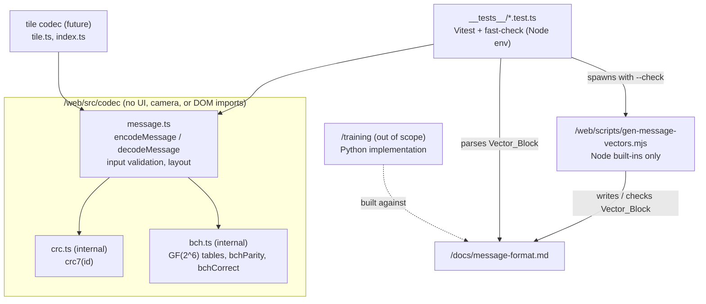
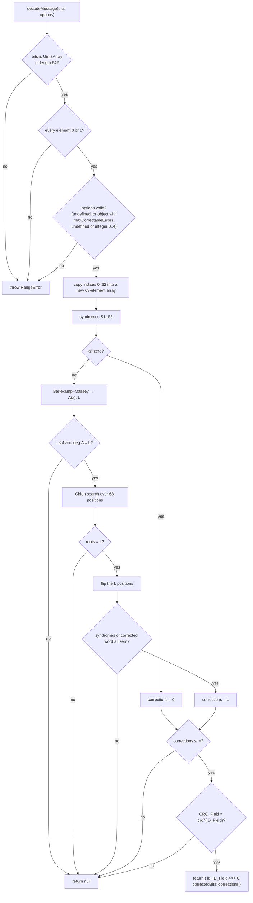

# Design Document: Message Codec

## Overview

The Message Codec maps a 32-bit Product_ID to a fixed 64-bit Message and back. It is a pure TypeScript module at `/web/src/codec/message.ts` with two exports, `encodeMessage` and `decodeMessage`, plus two internal helper modules for the CRC-7 and the BCH(63,39) code. A successful decode returns the Product_ID together with `correctedBits`, the number of Codeword bits the BCH decoder repaired. The Format_Document `/docs/message-format.md` is the authoritative cross-language contract; this design fixes every parameter that document has to state. Its test vectors are written by a committed, independent generator script, `/web/scripts/gen-message-vectors.mjs`, which shares no code with the codec.

The Layout is fixed by the requirements and is not revisited here:

| Message indices | Width | Field | Content |
|---|---|---|---|
| 0–31 | 32 | ID_Field | Product_ID, MSB at index 0 |
| 32–38 | 7 | CRC_Field | CRC-7 of the Product_ID, MSB at index 32 |
| 39–62 | 24 | Parity_Field | Systematic BCH(63,39) parity over indices 0–38 |
| 63 | 1 | Spare_Field | Written 0, ignored on decode (Spare_Bit_Option_B) |

Decode order: BCH correction of indices 0–62, then reject if the correction count exceeds `maxCorrectableErrors` (default 4), then check CRC-7, then return `{ id, correctedBits }` or `null`.

### Decisions in this design

| # | Decision | Status |
|---|---|---|
| D1 | CRC-7 = CRC-7/MMC polynomial 0x09 (x^7 + x^3 + 1), init 0x00, no input or output reflection, **final XOR 0x7F**, over the ID bits at Message indices 0–31 fed MSB first, result written MSB first to indices 32–38. | **Approved by the user.** |
| D2 | GF(2^6) built from the primitive polynomial x^6 + x + 1 (0x43). g(x) = 0x1DB2777 (degree 24). | Final |
| D3 | Bit-array representation (`Uint8Array` of 0/1) with precomputed syndrome tables; no BigInt. | Final |
| D4 | Decoder: syndromes S1..S8, Berlekamp–Massey, Chien search, syndrome re-check after correction. `correctedBits` = number of positions located and flipped. | Final |
| D5 | Test vectors live in one Vector_Block in `/docs/message-format.md`, delimited by HTML comment markers around a fenced `json tilemark-test-vectors` block. The test suite parses the document directly. | Final |
| D6 | Bulk measurements use a seeded mulberry32 PRNG with a fully specified draw order; fast-check properties use a fixed fast-check seed. | Final |
| D7 | Default `maxCorrectableErrors` stays 4 (required by Requirement 9.7). | Final |
| D8 | The Vector_Generator uses a deliberately different technique from the codec: augmented polynomial long division on explicit coefficient arrays, and it re-derives g(x) from minimal polynomials as a self-check. The codec uses packed-integer LFSRs for encoding and table-driven syndromes for decoding. | Final |
| D9 | The decoder ignores the Spare_Field (Spare_Bit_Option_B), chosen by the user after the Spare-bit analysis (Requirement 15). Spare_Bit_Option_A will not be implemented. | **Approved by the user.** |

### Research summary

- **CRC-7 variants.** The CRC RevEng catalogue lists CRC-7/MMC (width 7, poly 0x09, init 0x00, refin false, refout false, xorout 0x00, check 0x75), CRC-7/ROHC (poly 0x4F, init 0x7F, reflected), and CRC-7/UMTS (poly 0x45, init 0x00). Source: [CRC RevEng catalogue, 7-bit CRCs](https://reveng.sourceforge.io/crc-catalogue/1-15.htm). CRC-7/MMC is the SD/MMC command CRC and the most widely implemented. Its polynomial x^7 + x^3 + 1 is primitive, so it detects every 2-bit error within a 127-bit span.
- **BCH(63,39), t = 4.** A narrow-sense primitive binary BCH code of length 63 with designed distance 9 has generator g(x) = lcm(m1, m3, m5, m7), each minimal polynomial of degree 6, giving 63 − 24 = 39 message bits. Reference: Lin and Costello, *Error Control Coding*, 2nd ed., ch. 6; the [Wikipedia BCH code article](https://en.wikipedia.org/wiki/BCH_code) gives the same construction and the Berlekamp–Massey / Chien decoding steps.
- **Affine CRC parameters do not change error detection.** For a fixed message length, init and xorout add the same constant to every CRC value. For two IDs a and a ⊕ x, CRC(a) ⊕ CRC(a ⊕ x) depends only on x and the polynomial. A miscorrection therefore passes or fails the check independently of init/xorout. The prototype confirmed this: the heavy-corruption counts were identical with xorout 0x00 and 0x7F (see Correction_Limit_Comparison).
- **Throwaway prototype.** An earlier Node script in `%TEMP%\tilemark-proto` (not in the repo) implemented this design to compute g(x), timings, preliminary vectors, and preliminary rates. Numbers marked "preliminary" below come from it. It is not a source of record: the committed Vector_Generator produces the Test_Vectors, and the Property_Test_Suite produces the measured rates.

## Architecture



The module names `message.ts`, `bch.ts`, and `crc.ts` match tile-codec design section 8. The GF(2^6) arithmetic lives inside `bch.ts`; no separate `gf64.ts` is added. The Vector_Generator has no edge into `/web/src/codec`; the vector tests read the document, never the generator (Requirement 14.11).

### Decode flow



Index 63 (Spare_Field) is never read after validation. This gives Requirement 3.6 by construction, and `correctedBits` can never count it because the corrector only sees indices 0–62.

## Components and Interfaces

### `message.ts` (public)

```typescript
export interface DecodeOptions {
  /** Integer 0..4. Default 4. A read needing more corrections is rejected before the CRC check. */
  maxCorrectableErrors?: number
}
export type DecodeResult = {
  /** Decoded Product_ID, unsigned, 0..2^32-1. */
  id: number
  /** Codeword positions (Message indices 0..62) the BCH decoder located and flipped. 0..maxCorrectableErrors. Never counts the Spare_Field. */
  correctedBits: number
} | null

/** Returns a new Uint8Array(64) of 0/1 values. Throws RangeError for invalid id. */
export function encodeMessage(id: number): Uint8Array

/** Pure and stateless. Throws RangeError only for invalid arguments. */
export function decodeMessage(bits: Uint8Array, options?: DecodeOptions): DecodeResult
```

`encodeMessage(id)`:
1. Validate: `typeof id === 'number' && Number.isInteger(id) && id >= 0 && id <= 0xFFFFFFFF`, otherwise throw `RangeError`. This rejects NaN, ±Infinity, fractions, negatives, values ≥ 2^32, and every non-number (strings, `bigint`, `null`, `undefined`). The value −0 passes and encodes as 0. The Reserved_ID 0 is a valid input.
2. Allocate `new Uint8Array(64)` per call (Requirement 1.3: a caller modifying an earlier result cannot affect later results).
3. Indices 0–31: `m[i] = (id >>> (31 - i)) & 1`.
4. Indices 32–38: `c = crc7(id)`, `m[32 + i] = (c >>> (6 - i)) & 1`.
5. Indices 39–62: `bchParity(m)` reads indices 0–38 and writes indices 39–62.
6. Index 63: left 0.

`decodeMessage(bits, options)`:
1. `bits instanceof Uint8Array && bits.length === 64`, else `RangeError`. `Int8Array`, `Uint8ClampedArray`, and plain arrays fail `instanceof Uint8Array`. A Node `Buffer` is a `Uint8Array` subclass and is accepted.
2. Every element is 0 or 1, else `RangeError`.
3. Options: `options === undefined` → m = 4. Otherwise `typeof options !== 'object' || options === null` → `RangeError`. Read `options.maxCorrectableErrors` once into a local. `undefined` → m = 4. Otherwise it must satisfy `typeof v === 'number' && Number.isInteger(v) && v >= 0 && v <= 4`, else `RangeError`. −0 counts as 0. Other properties are ignored.
4. Copy `bits[0..62]` into a fresh `Uint8Array(63)`; the input is never written (Requirement 3.9). The options object is only read.
5. `n = bchCorrect(copy)`. If `n < 0` (uncorrectable) or `n > m`, return `null` without computing the CRC (Requirements 3.4, 4.5).
6. Read the ID from `copy[0..31]` as `id = ((id << 1) | bit)` then `id >>> 0` so IDs ≥ 2^31 stay non-negative (Requirement 5.2). Read the CRC from `copy[32..38]`.
7. Return `{ id, correctedBits: n }` if the CRC matches `crc7(id)`, else `null`.

Validation order is bits type/length, bits values, then options. Every invalid argument throws `RangeError`, whatever the other argument is, so the order only affects which message the error carries.

Downstream use of `correctedBits`: the tile codec's confidence score (tile-codec design section 6, `errors_corrected`) reads `correctedBits` directly. No second export and no repeated decodes are needed.

### `crc.ts` (internal)

```typescript
/** CRC-7 of a 32-bit unsigned id, per /docs/message-format.md. Returns 0..127. */
export function crc7(id: number): number
```

Non-augmented MSB-first shift register on a packed integer, 32 iterations: for b = 31 down to 0, `fb = ((reg >>> 6) & 1) ^ ((id >>> b) & 1)`; `reg = (reg << 1) & 0x7F`; `if (fb) reg ^= 0x09`. Start `reg = 0x00`; return `reg ^ 0x7F`. A 32-step loop is cheap enough that no lookup table is needed.

### `bch.ts` (internal)

```typescript
/** Reads m[0..38], writes the 24 systematic parity bits into m[39..62]. */
export function bchParity(m: Uint8Array): void
/** Corrects a 63-element 0/1 array in place. Returns the correction count 0..4, or -1 if uncorrectable. */
export function bchCorrect(r: Uint8Array): number
```

Module-level immutable tables, built once at import:
- `EXP` (126 entries, doubled to avoid a modulo) and `LOG` (64 entries) for GF(2^6) with primitive polynomial 0x43.
- `SYN[j][i] = α^((j · (62 − i)) mod 63)` for j ∈ {1, 3, 5, 7} and i ∈ [0, 62]: four `Uint8Array(63)` rows.

`bchParity`: packed-integer LFSR division by g(x). `reg = 0`; for i = 0..38: `fb = m[i] ^ ((reg >>> 23) & 1)`, `reg = (reg << 1) & 0xFFFFFF`, `if (fb) reg ^= 0xDB2777` (g without its x^24 term). Then `m[39 + j] = (reg >>> (23 - j)) & 1` for j = 0..23. Index 39 receives the x^23 coefficient and index 62 the x^0 coefficient (Requirement 2.3).

`bchCorrect` steps:
1. **Syndromes.** S1, S3, S5, S7 by XOR-summing `SYN` rows over set bits. Even syndromes by squaring: S2 = S1², S4 = S2², S6 = S3², S8 = S4². Return 0 if all are zero.
2. **Berlekamp–Massey** over GF(2^6), the standard form with 2t = 8 iterations. It produces Λ(x) = 1 + Λ1 x + … and the LFSR length L. Fixed arrays of 9 coefficients, no allocation in the loop.
3. **Failure checks.** If L > 4, or any coefficient of Λ above degree L is nonzero, return −1.
4. **Chien search.** For each index i ∈ [0, 62] with degree p = 62 − i, test Λ(α^(−p)) = 0. Collect the root positions. If the number of roots ≠ L, return −1. This covers locator polynomials with repeated roots or roots outside GF(2^6).
5. **Flip** the root positions.
6. **Re-check.** Recompute S1, S3, S5, S7 on the corrected word. If any is nonzero, return −1. Over 550,000 prototype decodes this check never fired after steps 3–4 passed. It is kept as a cheap guard (about 250 table XORs) so an algebra slip shows up as a rejection, not a miscorrection.
7. Return L. This is the Corrected_Error_Count: the number of distinct positions flipped in step 5.

### Vector_Generator: `/web/scripts/gen-message-vectors.mjs`

A committed plain Node ES module, run as `node scripts/gen-message-vectors.mjs [--check]` from `/web`. No build step, no `package.json` dependency, and imports only `node:fs`, `node:path`, `node:url`, and `node:process` (Requirements 14.1, 14.2). It has zero imports from `/web/src/codec`. An `npm run gen:vectors` script entry may be added for convenience; it is not required.

**Independent technique (D8).** The codec uses packed-integer LFSRs (`crc.ts`, `bchParity`) and table-driven syndrome decoding. The generator works on explicit coefficient arrays (JavaScript arrays of 0/1, index 0 = highest degree) with augmented long division:

- `polyMod(dividend, divisor)`: for i from 0 to `dividend.length − divisor.length`, if `dividend[i] === 1`, XOR `divisor` into `dividend[i .. i + divisor.length − 1]`. Returns the last `divisor.length − 1` entries.
- **CRC-7:** `P = [1,0,0,0,1,0,0,1]` (x^7 + x^3 + 1). Dividend = 32 ID bits MSB first followed by 7 zeros (the augmented message). Remainder → 7-bit integer, then XOR 0x7F. With init 0x00 and no reflection, this equals the shift-register form in `crc.ts`, but is computed a different way.
- **BCH parity:** Dividend = 39 data bits (ID_Field then CRC_Field) followed by 24 zeros. Remainder (24 coefficients, x^23 first) is the Parity_Field. Self-check: `polyMod` of the full 63-bit Codeword by g(x) is all zeros.
- **g(x) self-check:** the generator holds g(x) = 0x1DB2777 as a constant copied from the Format_Document parameters, and also re-derives it: build GF(2^6) from p(x) = x^6 + x + 1, form the cyclotomic cosets of 1, 3, 5, 7 modulo 63, compute each minimal polynomial as Π(x − α^j) over its coset with GF(2^6) coefficient arithmetic, and multiply the four over GF(2). It also checks that g(x) divides x^63 + 1. Any mismatch exits with code 3 before touching the document.

**Input constants (Requirement 14.4).**

```js
const CLEAN_IDS = [0, 1, 0x12345678, 0x80000000, 0xDEADBEEF, 0xFFFFFFFF]
const CORRUPTED = [
  { originalId: 0x12345678, flipped: [3, 17, 35, 58],
    expected: { id: 0x12345678, correctedBits: 4 } },
  { originalId: 0xDEADBEEF, flipped: [0, 9, 21, 33, 44, 52, 60, 63],
    expected: null },
]
```

Everything else (hex strings, CRC_Field and Parity_Field hex, 64-bit strings) is computed. The generator does not contain a decoder, so the expected results of the Corrupted_Test_Vectors are stated constants. The 4-flip vector's result follows from BCH theory (4 distinct flips within indices 0–62, t = 4). The `null` vector's result is checked against `decodeMessage` by the vector test (Requirement 10.13). If that test shows a non-null result, the flip set constant is changed and the generator re-run; the expected value is not edited to match. The generator also validates its constants: flipped indices distinct and in [0, 63], the 4-flip vector has exactly 4 indices all in [0, 62], and the clean set includes 0, 1, and 0xFFFFFFFF with at least 5 distinct IDs.

**Vector_Block markers (D5).** In the Format_Document the Vector_Block is the content between these two lines, each on a line of its own:

```
<!-- tilemark-test-vectors:begin -->
<!-- tilemark-test-vectors:end -->
```

The generated content is a markdown table (Product_ID decimal, hex, CRC_Field hex, Parity_Field hex) for the Clean_Test_Vectors, a table of the Corrupted_Test_Vectors (original ID decimal and hex, flipped indices, expected result), and one fenced block tagged `json tilemark-test-vectors` holding the JSON below. Because both the human-readable tables and the JSON are generated, nothing in the block can drift from the computation.

**Deterministic output (Requirement 14.6).** The JSON is serialized by a small hand-written emitter with fixed key order and one vector per line, not by `JSON.stringify` with object spread. Lines end in LF, the block ends with a newline, and it contains no timestamps, random values, paths, or Node version strings.

**Write mode (no arguments).** Read the document as UTF-8. Find the begin and end marker lines (matching the marker text with an optional trailing `\r`). Require exactly one of each, with begin before end. Replace only the bytes strictly between the end of the begin-marker line and the start of the end-marker line, write the file, exit 0. Bytes outside the block, including any CRLF line endings there, are kept as they were (Requirement 14.5). Running twice gives a byte-identical file.

**Check mode (`--check`).** Same location logic, no write. Normalize CRLF to LF in the existing block, then compare with the computed block. Equal → exit 0. Different → exit 1 and print the first difference: the generator parses the existing JSON fence and compares entry by entry (`clean[0..5]`, then `corrupted[0..1]`), printing e.g. `first differing vector: clean[2] (id 0x12345678)`. If every entry matches, or the JSON cannot be parsed, it prints `difference lies outside every Test_Vector` plus the first differing line number within the block (Requirement 14.7).

**Error exits (Requirement 14.9).** All return a nonzero code, print one line to stderr naming the problem, and write nothing:

| Condition | Exit code | Message |
|---|---|---|
| Any argument other than a single `--check` (checked before reading the file) | 2 | `unknown argument: <arg>` |
| `/docs/message-format.md` missing or unreadable | 2 | `Format_Document not found: docs/message-format.md` (repo-relative path) |
| No begin or no end marker | 2 | `no Vector_Block found` |
| More than one begin or end marker, or end before begin | 2 | `expected exactly one Vector_Block, found <n>` |
| g(x) self-check or codeword self-check fails | 3 | `generator self-check failed: <detail>` |
| `--check` mismatch | 1 | as above |

The document path is resolved with `new URL('../../docs/message-format.md', import.meta.url)`, so the result does not depend on the working directory.

### Representation choice (D3)

| Option | Per-call cost | Complexity | Verdict |
|---|---|---|---|
| `Uint8Array` bits + precomputed syndrome rows | Prototype: 0.0027 ms mean (0–4 flips), 0.0021 ms (random input) in Node 24 | Lowest. Direct mapping from index to polynomial degree | **Chosen** |
| Two 32-bit words, bit-sliced syndromes | Somewhat faster | Index bookkeeping across the word boundary; more error-prone | Rejected: the budget is 1 ms and the chosen option is ~370× under it |
| BigInt 64-bit word | Slowest; allocates per operation | Easy masks, but BigInt ops in JS engines are much slower than Number ops | Rejected |

The API already takes and returns `Uint8Array` bits, so the chosen form also avoids packing and unpacking. Adding `correctedBits` to the result costs nothing: it is the L already computed.

### Statelessness

The only module-level values are the immutable tables above. No caches, counters, or reused scratch buffers. Every scratch array is allocated per call, so `decodeMessage` gives equal results (same `id` and `correctedBits`, or `null`) for equal arguments whatever came before (Requirement 12.6).

## Data Models

### Format_Document outline (`/docs/message-format.md`)

Sections, in order:
1. **Status.** The document is the single authoritative cross-language contract for the Message, including the CRC-7 definition. `message.ts` and any Python implementation in `/training` must match it. If an implementation differs, the implementation is fixed, not the document (Requirements 10.1, 10.2).
2. **Layout.** Field table with inclusive index ranges, widths, and bit order (Requirement 10.3).
3. **CRC-7.** Parameter table, pseudocode, worked values (below; Requirements 10.4, 10.15).
4. **BCH(63,39).** Parameter table and coefficient-to-index mapping (below; Requirement 10.5), with parity pseudocode.
5. **Spare bit.** Written 0, not protected by the BCH code, ignored by the decoder (Spare_Bit_Option_B, chosen by the user under Requirement 15) (Requirement 10.6).
6. **Decoding and options.** Decode order, `maxCorrectableErrors` (0–4, default 4, a read needing more corrections is rejected before the CRC check), and the Decode_Result `{ id, correctedBits } | null`, where `correctedBits` is the number of Codeword positions corrected, in [0, maxCorrectableErrors], never counting the Spare_Field (Requirement 10.7).
7. **Reserved ID.** Product_ID 0 is reserved and never assigned to a product in the Product_Catalog. `encodeMessage` still accepts 0; the reservation is a catalog rule enforced outside the codec (Requirement 10.16).
8. **Test vectors.** One paragraph stating that the Vector_Block is written by `/web/scripts/gen-message-vectors.mjs`, that it is the cross-language contract, and that the Python implementation is checked against the same vectors outside this spec (Requirement 14.10), followed by the Vector_Block.
9. **Residual risk.** See below (Requirement 12).

### CRC-7 parameters (D1, approved)

| Parameter | Value |
|---|---|
| Width | 7 |
| Generator polynomial | x^7 + x^3 + 1 (0x09, normal form without the x^7 term) |
| Initial value | 0x00 |
| Input reflection | false |
| Output reflection | false |
| Final XOR | **0x7F** |
| Input | the 32 ID bits only (Message indices 0–31), most significant first, no padding or byte framing |
| Output | 7-bit result, MSB at Message index 32, LSB at index 38 |
| Core check value | the polynomial/init/no-reflection core over ASCII "123456789" gives 0x75, matching catalogued CRC-7/MMC; the final XOR is applied after. Implementers can check their core against the catalogue |

Pseudocode for the Format_Document (language-neutral, integer operations only):

```
reg = 0x00
for b = 31 down to 0:
    fb  = ((reg >> 6) & 1) XOR ((id >> b) & 1)
    reg = (reg << 1) & 0x7F
    if fb == 1: reg = reg XOR 0x09
crc = reg XOR 0x7F
```

Worked values, traced by hand from the pseudocode:
- **ID 0 → 0x7F.** Every input bit is 0 and `reg` starts at 0, so `fb` is always 0 and `reg` stays 0x00. 0x00 XOR 0x7F = 0x7F.
- **ID 1 → 0x76.** Bits 31..1 are 0, so `reg` stays 0x00. At b = 0, `fb` = 0 XOR 1 = 1, `reg` = 0x00 then XOR 0x09 = 0x09. 0x09 XOR 0x7F = 0x76.
- **ID 2 → 0x6D.** `reg` stays 0x00 through b = 2. At b = 1, `fb` = 1, `reg` = 0x09. At b = 0, `fb` = bit 6 of 0x09 (0) XOR 0 = 0, `reg` = 0x12. 0x12 XOR 0x7F = 0x6D.

The CRC_Field hex for every Clean_Test_Vector appears in the generated Vector_Block table. The values in the preliminary table below are from the prototype; the generator output is authoritative.

Why the final XOR (approved rationale, kept for the record):
- The BCH code is linear, so the all-zero 63-bit word is always a codeword. With catalogued CRC-7/MMC, crc7(0) = 0x00, and the all-zero Message would be exactly `encodeMessage(0)`. A blank, all-white, or fully under-exposed read would then decode to Product_ID 0, along with every read within 4 bit errors of blank.
- With final XOR 0x7F, crc7(0) = 0x7F. The all-zero word passes BCH with zero corrections and then fails the CRC. Prototype: 20,000 reads with 0–4 random flips from all-zero gave 0 non-null results.
- The all-ones 63-bit word is also a BCH codeword, because g(1) ≠ 0. It carries ID 0xFFFFFFFF with CRC field 0x7F. crc7(0xFFFFFFFF) = 0x6A with this variant, so the all-ones read (all black, spare 0 or 1) is also rejected.
- Error detection is unchanged (see Research summary), so the measured false-accept rates are the same as for plain CRC-7/MMC.
- The Reserved_ID rule is a second, independent layer: even if a blank-like read somehow decoded to 0, the scanner's catalog check would not show it, because 0 is never in the Product_Catalog.

Alternatives considered:

| Alternative | Why not chosen |
|---|---|
| Catalogued CRC-7/MMC (xorout 0) with only the ID 0 catalog reservation | The codec would accept the blank read as a valid decode and rely on the scanner alone to drop it. The XOR rejects it in the codec. |
| Nonzero init (e.g. 0x7F) instead of final XOR | Same effect, but just as uncatalogued, and the XOR-after form is easier to verify against the 0x75 check value. |
| CRC-7/ROHC (init 0x7F, catalogued) | Reflected input conflicts with the MSB-first 32-bit feed; bit order becomes ambiguous across languages. |
| XOR mask over the whole Codeword (QR-style) | Changes ID_Field bits (breaks Requirement 2.1) or makes the Codeword a non-codeword (breaks Requirement 1.6). |

### GF(2^6) and BCH(63,39) parameters (D2)

| Parameter | Value |
|---|---|
| Field | GF(2^6), primitive polynomial p(x) = x^6 + x + 1 (0x43), α a root of p |
| Code length n | 63 (Message indices 0–62) |
| Message length k | 39 (Message indices 0–38: ID_Field then CRC_Field) |
| Correction_Limit t | 4 (designed distance 9) |
| Minimal polynomials | m1 = 0x43 (x^6+x+1), m3 = 0x57 (x^6+x^4+x^2+x+1), m5 = 0x67 (x^6+x^5+x^2+x+1), m7 = 0x49 (x^6+x^3+1) |
| Generator | g(x) = m1·m3·m5·m7 = **0x1DB2777** = x^24 + x^23 + x^22 + x^20 + x^19 + x^17 + x^16 + x^13 + x^10 + x^9 + x^8 + x^6 + x^5 + x^4 + x^2 + x + 1 |
| Check | g(x) divides x^63 + 1 (verified in the prototype; re-verified by the generator on every run) |
| Systematic form | c(x) = d(x)·x^24 + (d(x)·x^24 mod g(x)) |
| Coefficient mapping | Message index i ↔ coefficient of x^(62 − i), for i ∈ [0, 62]. Index 0 = x^62 (ID MSB), index 38 = x^24 (CRC LSB), index 39 = x^23, index 62 = x^0 |

Parity pseudocode for the Format_Document:

```
reg = 0                      # 24-bit register
for i = 0 to 38:             # Message indices 0..38
    fb  = bit[i] XOR ((reg >> 23) & 1)
    reg = (reg << 1) & 0xFFFFFF
    if fb == 1: reg = reg XOR 0xDB2777
for j = 0 to 23:
    bit[39 + j] = (reg >> (23 - j)) & 1
```

### Message and Codeword

- `Uint8Array(64)`, values 0/1, index 0 = Message bit 0.
- Codeword = indices 0–62. The decoder works on a 63-element copy.

### Test vectors (preliminary values from the prototype)

These are the vector inputs the generator holds as constants, with the outputs the prototype computed for them. The committed Vector_Generator recomputes every output; if any differs from this table, the generator's output is used and this table is corrected. Bit strings list Message indices 0 to 63, left to right.

| Product_ID (dec) | Hex | CRC_Field | Parity_Field | Message bits 0–63 |
|---|---|---|---|---|
| 0 | 0x00000000 | 0x7F | 0x7C7BA4 | `0000000000000000000000000000000011111110111110001111011101001000` |
| 1 | 0x00000001 | 0x76 | 0x96765B | `0000000000000000000000000000000111101101001011001110110010110110` |
| 305419896 | 0x12345678 | 0x7B | 0x41EDEF | `0001001000110100010101100111100011110110100000111101101111011110` |
| 2147483648 | 0x80000000 | 0x64 | 0x9425C4 | `1000000000000000000000000000000011001001001010000100101110001000` |
| 3735928559 | 0xDEADBEEF | 0x13 | 0xA772A1 | `1101111010101101101111101110111100100111010011101110010101000010` |
| 4294967295 | 0xFFFFFFFF | 0x6A | 0x23099C | `1111111111111111111111111111111111010100010001100001001100111000` |

Every clean vector's expected Decode_Result is `{ id, correctedBits: 0 }`.

Corrupted_Test_Vectors:

| Original ID | Flipped indices | Received Message bits 0–63 | Expected (default m = 4) |
|---|---|---|---|
| 305419896 (0x12345678) | 3, 17 (ID), 35 (CRC), 58 (parity): 4 Codeword flips | `0000001000110100000101100111100011100110100000111101101111111110` | `{ "id": 305419896, "correctedBits": 4 }` (with m = 3: `null`) |
| 3735928559 (0xDEADBEEF) | 0, 9, 21, 33, 44, 52, 60, 63: 7 Codeword flips + spare | `0101111011101101101110101110111101100111010001101110110101001011` | `null` |

### Vector_Block JSON format (D5)

```json
{
  "formatVersion": 1,
  "clean": [
    { "id": 0, "idHex": "0x00000000", "crcHex": "0x7F", "parityHex": "0x7C7BA4",
      "bits": "0000…1000", "expected": { "id": 0, "correctedBits": 0 } }
  ],
  "corrupted": [
    { "originalId": 305419896, "originalIdHex": "0x12345678",
      "flipped": [3, 17, 35, 58], "bits": "0000…1110",
      "expected": { "id": 305419896, "correctedBits": 4 } },
    { "originalId": 3735928559, "originalIdHex": "0xDEADBEEF",
      "flipped": [0, 9, 21, 33, 44, 52, 60, 63], "bits": "0101…1011",
      "expected": null }
  ]
}
```

(Shown wrapped; the generator emits one vector object per line.)

Why the tests parse the document instead of a TS fixture: Requirement 10.2 makes the document authoritative, so the test reads the authoritative copy. A TS fixture would be a second copy that could drift. The Python side can parse the same block. The vector test locates the Vector_Block by its markers, extracts the single `json tilemark-test-vectors` fence, and checks its shape: exactly one Vector_Block and one fence; `bits` matches `/^[01]{64}$/`; `idHex` equals the hex of `id`; `crcHex` is present for each clean vector; the clean set includes 0, 1, and 4294967295 with at least 5 distinct IDs; one corrupted vector has exactly 4 flipped indices in [0, 62] and expected `correctedBits` 4; one corrupted vector expects `null`.

### Residual risk section and scanner obligations (Requirement 12)

The Format_Document's "Residual risk" section states that the Message_Codec alone does not satisfy "never show a wrong product", because the measured False_Accept_Rate (Requirement 7) and Random_Input_Acceptance_Rate (Requirement 8) are not zero. It then gives:
- The combined k ≥ 8 False_Accept_Rate at m = 4 with its False_Accept count, trial count, and seed, and the random-input acceptance rate at m = 4 with its non-null count, trial count, and seed, copied from the Property_Test_Suite output. Until those tests have run, each value reads "not yet measured" and the bounds are stated instead (at most 1 × 10⁻³ and at most 0.1%). The prototype numbers in this design are never copied there.
- A note that these are single-decode rates and the scanner's Confirmation_Count N is applied on top of them.
- Two scanner obligations, each referencing `.kiro/specs/scanner/requirements.md`: (a) show a decoded Product_ID only if it is in the Product_Catalog (Scanner_Spec Requirement 1, "Catalog check"); (b) show it only after a configurable number N of consecutive decode attempts return the same catalog Product_ID (Scanner_Spec Requirement 2). N is the Confirmation_Count, with candidate values 2 or 3; the user picks one after decode times have been measured.

The codec implements neither obligation, takes no catalog argument, and keeps no state between calls.

### Seeded PRNG and draw procedure (D6)

- **Generator:** mulberry32, 32-bit state, returns a uint32 per call. Public-domain algorithm, a few lines in the test helpers, no dependency.
- **Seed:** `MEASUREMENT_SEED = 0x2545F491` (625341585), shared by Requirement 7 and 8 runs. Each run creates a fresh generator from the seed, so the m = 4 and m = 3 runs see identical inputs.
- **Requirement 7 trial order:** for k in [5, 6, 7, 8, 12, 16, 32] in that order, 25,000 trials each, one generator for the whole run. Per trial: `id = next()`; `m = encodeMessage(id)`; partial Fisher–Yates on `idx = [0..63]`: for j = 0..k−1, `s = j + floor(next() * (64 − j) / 2^32)`, swap `idx[j]` and `idx[s]`, flip `m[idx[j]]`; then `decodeMessage(m, { maxCorrectableErrors })`. Classification uses `id` only; `correctedBits` is ignored (Requirement 7.3).
- **Requirement 8 trial order:** 100,000 trials, one generator per run. Per trial: `a = next()`, `b = next()`, `m[i] = (a >>> (31 − i)) & 1` and `m[32 + i] = (b >>> (31 − i)) & 1` for i ∈ [0, 31].
- **Requirement 15 measurements:** the Spare_Bit_Analysis reuses the Requirement 7 and 8 draws with the same seed. The Genuine_Read draw order (seed `GENUINE_SEED = 0x6A09E667`) is specified in the Spare-bit analysis section.
- **fast-check:** `FC_SEED = 0x7113A5C1`, passed as `fc.assert(prop, { seed: FC_SEED, numRuns })`. Uniform draws use `fc.noBias(...)`, because fast-check's default integer arbitrary is biased toward small and edge values, which would break the "uniformly at random" wording in Requirements 5.3 and 6.5. Required fixed IDs (0, 1, 2^32 − 1) are supplied through the `examples` option, so they run in addition to the random cases.

Specifying the draw order exactly means the Property_Test_Suite should reproduce the prototype's counts below, provided its `encodeMessage` matches. The suite's output is authoritative either way.

### Measurement output format

Each measurement test prints before asserting, so the output appears whether it passes or fails (Requirement 7.6). The output is one machine-readable line and a markdown table ready to paste:

```
[message-codec] falseAccept m=4 seed=0x2545F491 {"perK":{"5":{"n":25000,"correct":…,"null":…,"falseAccept":…,"rate":…},…},"k>=8":{…},"total":{…}}
| k | trials | correct | null | false accept | rate |
|---|---|---|---|---|---|
…
note: k = 5, 6, 7 exceed the Correction_Limit (t = 4); a higher false-accept rate than k ≥ 8 is expected. No bound applies to them or to m = 3.
```

Requirement 8 prints `[message-codec] randomInput m=4 seed=… trials=… null=… nonNull=… rejectionRate=…`. Timing prints `[message-codec] timing kind=flips0to4 calls=10000 meanMs=…`. The Correction_Limit_Comparison and the "Residual risk" section are updated by hand from this output.

## Correctness Properties

*A property is a characteristic or behavior that should hold true across all valid executions of a system-essentially, a formal statement about what the system should do. Properties serve as the bridge between human-readable specifications and machine-verifiable correctness guarantees.*

Reflection on redundancy: the layout criteria (1.1, 1.2, 1.5–1.7, 2.1–2.5) are merged into one encoder-structure property, because a wrong bit order in any field already breaks that check. 6.1 is subsumed by 6.2. 3.2, 3.3, and part of 4.7 are covered by the round-trip and within-limit properties. 4.1, 4.2, and 9.7 are merged into one option-equivalence property. Properties 1–13 are fast-check properties. Properties 14 and 15 are seeded single-run measurements, and Property 16 ranges over the finite vector set in the Format_Document. The Requirement 15 measurements are reported without bounds and are listed in the Testing Strategy, not as properties.

### Property 1: Encoder output structure and layout

*For any* valid Product_ID `id`, `encodeMessage(id)` returns a `Uint8Array` of length 64 with every element in {0, 1}, where: indices 0–31 read MSB-first equal `id`; indices 32–38 read MSB-first equal a reference CRC-7 computed in the test from the Format_Document parameters; the polynomial Σ m[i]·x^(62−i) over indices 0–62 is divisible by g(x) = 0x1DB2777 (checked by an independent long division in the test); and index 63 is 0.

**Validates: Requirements 1.1, 1.2, 1.5, 1.6, 1.7, 2.1, 2.2, 2.3, 2.4, 2.5**

### Property 2: Encoding is deterministic and isolated from caller mutation

*For any* valid Product_ID `id` and any set of index/value writes applied to the array returned by a first `encodeMessage(id)` call, a second `encodeMessage(id)` call returns an array equal, element by element, to the unmutated first result (captured as a copy before mutation), and is a different array object.

**Validates: Requirements 1.3**

### Property 3: Round trip

*For any* valid Product_ID `id` and any options in {omitted, m = 0, 1, 2, 3, 4}, `decodeMessage(encodeMessage(id), options)` returns an object whose `id` is `===` to `id` and whose `correctedBits` is `===` 0, and that `id` is an integer in [0, 2^32 − 1].

**Validates: Requirements 5.1, 5.2, 3.3**

### Property 4: Errors within the limit are corrected and counted

*For any* valid Product_ID, any m in [0, 4] (or options omitted, treated as m = 4), any set of k distinct flipped Codeword positions in [0, 62] with k in [0, m], and either value of the Spare_Field, `decodeMessage` returns `{ id, correctedBits }` with `id` equal to the encoded Product_ID and `correctedBits` equal to k.

**Validates: Requirements 6.1, 6.2, 6.3, 3.2, 3.3, 4.7**

### Property 5: Errors beyond the option limit are rejected

*For any* valid Product_ID, any m in [0, 3], any k in [m + 1, 4], any set of exactly k distinct flipped Codeword positions, and either Spare_Field value, `decodeMessage` with option m returns `null`.

**Validates: Requirements 6.4, 4.5, 4.6, 4.7**

### Property 6: Monotonicity in the correction limit

*For any* valid Message (drawn both uniformly and as an encoded Message with 0–6 random flips) and any m < m′ in [0, 4]: if `decodeMessage` with m returns `{ id, correctedBits }`, then with m′ it returns a result with the same `id` and the same `correctedBits`; and if it returns `null` with m′, it returns `null` with m.

**Validates: Requirements 4.8**

### Property 7: Option forms that mean the same value give the same result

*For any* valid Message: no options, `undefined`, `{}`, and `{ maxCorrectableErrors: undefined }` all give the same result (same `id` and `correctedBits`, or `null`) as `{ maxCorrectableErrors: 4 }`. `{ maxCorrectableErrors: -0 }` gives the same result as `{ maxCorrectableErrors: 0 }`. And for any m in [0, 4], adding arbitrary extra properties to the options object does not change the result.

**Validates: Requirements 4.1, 4.2, 9.7**

### Property 8: Spare-bit independence

*For any* valid Message and any valid options, `decodeMessage` returns the same result (same `id` and same `correctedBits`, or `null` in both cases) for the Message and for the Message with index 63 flipped.

**Validates: Requirements 3.6**

### Property 9: Decoding valid input is total

*For any* valid Message (64 uniformly random bits, or an encoded Message with 0–32 random flips) and any valid options with limit m, `decodeMessage` does not throw, and returns either `null` or an object whose `id` is an integer in [0, 2^32 − 1] and whose `correctedBits` is an integer in [0, m].

**Validates: Requirements 3.10, 3.4**

### Property 10: Inputs are not modified

*For any* 64-element `Uint8Array` (valid, or with values in [2, 255] at random positions) and any options object (valid or invalid), after `decodeMessage` returns or throws, the input array has the same length and the same value at every index as a copy taken before the call, and the options object has the same own properties and values.

**Validates: Requirements 3.9**

### Property 11: Statelessness

*For any* valid Message `x`, valid options `o`, and any sequence of 0–20 other `decodeMessage` calls on random valid Messages with random valid options, `decodeMessage(x, o)` returns the same result (same `id` and `correctedBits`, or `null`) before and after the sequence.

**Validates: Requirements 12.6**

### Property 12: CRC mismatch is rejected

*For any* valid Product_ID `id` and any 7-bit value `c ≠ crc7(id)`, the Message built from ID_Field = `id`, CRC_Field = `c`, and the correct BCH parity for those 39 bits (an exact BCH codeword with a wrong checksum) decodes to `null` for every m in [0, 4].

**Validates: Requirements 3.5**

### Property 13: Invalid arguments throw RangeError

*For any* generated invalid argument, the call throws `RangeError`, whatever the other argument is. Invalid arguments cover: an `encodeMessage` input that is a non-integer number, a number outside [0, 2^32 − 1], or a non-number; a `decodeMessage` `bits` that is a valid Message with at least one element set to a value in [2, 255]; a `Uint8Array` of length ≠ 64; and a `maxCorrectableErrors` that is a non-integer or out-of-range number, or a non-number other than `undefined`.

**Validates: Requirements 1.4, 3.7, 3.8, 4.3, 4.4**

### Property 14: Bounded false accepts under heavy corruption (measured)

*For all* 100,000 trials with k ∈ {8, 12, 16, 32} in the seeded Requirement 7 procedure at m = 4, the number of False_Accepts divided by 100,000 is at most 1 × 10⁻³. Every trial at every k and both m values is classified by `id` alone into exactly one of correct / `null` / False_Accept, and no trial throws.

**Validates: Requirements 7.1, 7.2, 7.3, 7.4, 7.7, 7.8**

### Property 15: Random input is rejected (measured)

*For all* 100,000 trials of uniformly random 64-bit Messages in the seeded Requirement 8 procedure at m = 4, at least 99.9% return `null`, the `null` and non-null counts sum to the trial count, and no trial throws.

**Validates: Requirements 8.1, 8.2, 8.3, 8.5, 8.6, 8.7**

### Property 16: Format_Document vector conformance

*For every* Clean_Test_Vector in the Format_Document's Vector_Block, `encodeMessage(id)` equals the vector's bits at all 64 indices and `decodeMessage` with the default option returns `{ id, correctedBits: 0 }`. *For every* Corrupted_Test_Vector, the received bits equal `encodeMessage(originalId)` with exactly the listed indices flipped, and `decodeMessage` with the default option returns the listed expected result, compared on both `id` and `correctedBits` when non-null.

**Validates: Requirements 2.8, 10.12, 10.13, 10.14**

## Error Handling

| Condition | Behavior |
|---|---|
| `encodeMessage` with a non-number, non-integer, negative, or ≥ 2^32 value | `throw new RangeError('encodeMessage: id must be an integer in [0, 4294967295]')` |
| `decodeMessage` `bits` not a `Uint8Array` or length ≠ 64 | `RangeError` naming the actual type or length |
| `bits` element not 0/1 | `RangeError` naming the first offending index and value |
| `options` not `undefined` and not a non-null object | `RangeError` |
| `maxCorrectableErrors` defined but not an integer `number` in [0, 4] | `RangeError` showing the value with `String(v)` (safe for `bigint`, which `JSON.stringify` cannot handle) |
| BCH uncorrectable (L > 4, deg Λ ≠ L, roots ≠ L, nonzero re-check syndrome) | `null`, CRC not computed |
| Corrections > m | `null`, CRC not computed |
| CRC mismatch | `null` |
| Vector_Generator errors | Nonzero exit, one-line stderr message, document untouched (table in the Vector_Generator section) |

Design rules:
- `RangeError` only for argument errors. Any valid Message with valid options returns a value (Property 9). Decode failures are normal outcomes, so they return `null`, never throw.
- No logging and no console output in the codec. Measurement output comes only from tests.
- All validation runs before any work, so a throwing call has no partial effects. Inputs are never written in either case.

## Testing Strategy

Runner: Vitest in Node (`web/vitest.config.ts` already sets `environment: 'node'`). Run once with `npm test` in `/web` (`vitest run`). Property library: fast-check 4.10.2 (already a dev dependency, MIT). No new dependencies.

### Test files in `/web/src/codec/__tests__`

| File | Contents |
|---|---|
| `message.helpers.ts` | mulberry32, flip helpers, reference CRC-7 and g(x) long division (independent of `bch.ts`/`crc.ts`), `loadFormatVectors()` that reads `/docs/message-format.md` via `node:fs` and `new URL('../../../../docs/message-format.md', import.meta.url)` and extracts the Vector_Block by its markers, output formatters |
| `message.properties.test.ts` | Properties 1–13, one named `it` per property |
| `message.validation.test.ts` | Example tables for Requirements 1.4, 3.7, 3.8, 4.1–4.4 (`null`, `undefined`, plain array, `Int8Array`, `Uint8ClampedArray`, lengths 0/63/65, `"4"`, `4n`, `true`, `null`, NaN, ±Infinity, 0.5, 3.9, −1, 5, 2^32, −0); spy test that `crc7` is not called when BCH fails or corrections > m (Requirements 3.4, 4.5) via `vi.mock` of `../crc` |
| `message.edge.test.ts` | Requirement 5.4 explicit IDs × all option forms (`correctedBits` 0); Requirements 6.6 and 6.7 exhaustive single and pair flips for IDs 0 and 0xFFFFFFFF (expected `correctedBits` 1 and 2); 2.6 layout constants; all-zero and all-ones Messages decode to `null` (D1) |
| `message.vectors.test.ts` | Property 16 plus the Vector_Block shape checks from D5 (Requirements 10.8–10.11, 10.15 presence checks). Reads the document only; does not import or run the generator (Requirement 14.11) |
| `message.generator.test.ts` | Named test `vector generator --check matches Format_Document` (Requirement 14.8): `spawnSync(process.execPath, ['scripts/gen-message-vectors.mjs', '--check'], { cwd: <web root>, timeout: 10_000, encoding: 'utf8' })`. Fails if `error` is set (cannot start, or `ETIMEDOUT`), if `signal` is set, or if `status !== 0`; prints the generator's stdout and stderr on failure. The Vitest test timeout is set above 10 s (e.g. 15 s) so the spawn timeout fires first |
| `message.measure.test.ts` | Properties 14 and 15: named tests `false-accept m=4`, `false-accept m=3`, `random-input m=4`, `random-input m=3`; m = 3 tests assert only classification and no-throw, not a bound |
| `message.spare.test.ts` | Requirement 15, using the procedures and seeds defined in the Spare-bit analysis section: named test `spare-bit analysis m=4` (Criterion 1: Requirement 7 and 8 procedures with seed 0x2545F491, same counts; Option A derived from each trial's Option B result plus the spare bit) and named tests `genuine-read p=0.01`, `genuine-read p=0.03`, `genuine-read p=0.05` (Criterion 8: Genuine_Read procedure with seed 0x6A09E667, 100,000 trials per p; Option A derived from the Option B result plus the spare bit). All report without a pass or fail bound; they fail only on a throw or a count that does not sum to the trial count |
| `message.perf.test.ts` | Requirements 13.5–13.7: 1,000 warm-up + 10,000 timed calls with `performance.now()`, two input kinds, mean < 1 ms, prints calls and mean |
| `message.isolation.test.ts` | Requirements 13.2–13.3 and 14.2: reads `message.ts`, `bch.ts`, `crc.ts` and follows relative imports; fails on any import outside `/web/src/codec`, any import from `/ui`, and any occurrence of `window`, `document`, `navigator`, `getUserMedia`. Also reads `scripts/gen-message-vectors.mjs` and fails if any import or dynamic `import()` specifier does not start with `node:` |

The existing placeholder `web/src/tilemark.test.ts` is left alone.

### Property test configuration

- Each property is one `it(...)` with `fc.assert(fc.property(...), { seed: FC_SEED, numRuns })`.
- `numRuns`: 10,000 for Properties 3, 4, 5 (Requirements 5.3 and 6.5). Property 4 runs twice, once with options drawn as m ∈ [0, 4] and once with options omitted, flips in [0, 4] (Requirement 6.3). Properties 1, 2, 6–13 use at least 1,000 (well above the 100-iteration minimum; each run costs microseconds).
- Uniform draws: `fc.noBias(fc.integer({ min: 0, max: 0xFFFFFFFF }))` for IDs; flip count via `fc.noBias(fc.integer(...))`, then `fc.uniqueArray(fc.integer({ min: 0, max: 62 }), { minLength: k, maxLength: k })` through `chain`. IDs 0, 1, and 0xFFFFFFFF are added through `examples`.
- The seed is printed at the start of each property test. fast-check's failure report includes the seed, path, and counterexample (ID, options, flips, and the Decode_Result), which satisfies Requirement 5.5.
- Tag comment above each test: `// Feature: message-codec, Property {n}: {property title}`.

### Unit and example tests

These cover only what properties do not: the fixed edge IDs, exhaustive small-flip sets, the invalid-argument table, the CRC-not-called spy, blank/all-ones reads, the vector shape checks, and the generator `--check` run. They complement the properties without duplicating random coverage.

### Generator tests

Only the `--check` run above is part of the suite. The generator's error exits (Requirement 14.9) and CRLF tolerance (Requirement 14.7) are exercised by hand during implementation against a temporary copy of the document, because the suite must not write to `/docs`.

### Measurements

The measurement tests run in about 1.2 s total for Requirements 7 and 8 (prototype: 550,000 decodes); the Requirement 15 Genuine_Read runs add 300,000 decodes. They print in the format given in Data Models before asserting. If a trial throws, the test catches it, records the m value (or p), ID, and flipped indices (or the input Message for Requirement 8), prints them, and fails.

## Correction_Limit_Comparison

**Status: preliminary, to be confirmed by the Property_Test_Suite.** The numbers come from the throwaway prototype, which used the exact draw procedure in Data Models: seed 0x2545F491 (mulberry32), 25,000 trials per k, 175,000 trials per m value (100,000 with k ≥ 8), and 100,000 random-input trials per m. The same per-k counts and seed apply to both columns. Classification is by `id` alone. After the Property_Test_Suite runs, this table is replaced with the values from its output (Requirement 9.4).

### False accepts under heavy corruption (Requirement 7 procedure)

| k | trials | m = 4: correct / null / FA | m = 4 FA rate | m = 3: correct / null / FA | m = 3 FA rate |
|---|---|---|---|---|---|
| 5 | 25,000 | 2,017 / 22,981 / 2 | 8.0 × 10⁻⁵ | 0 / 25,000 / 0 | 0 |
| 6 | 25,000 | 0 / 24,993 / 7 | 2.8 × 10⁻⁴ | 0 / 25,000 / 0 | 0 |
| 7 | 25,000 | 0 / 24,995 / 5 | 2.0 × 10⁻⁴ | 0 / 25,000 / 0 | 0 |
| 8 | 25,000 | 0 / 24,990 / 10 | 4.0 × 10⁻⁴ | 0 / 25,000 / 0 | 0 |
| 12 | 25,000 | 0 / 24,991 / 9 | 3.6 × 10⁻⁴ | 0 / 24,999 / 1 | 4.0 × 10⁻⁵ |
| 16 | 25,000 | 0 / 24,997 / 3 | 1.2 × 10⁻⁴ | 0 / 25,000 / 0 | 0 |
| 32 | 25,000 | 0 / 24,993 / 7 | 2.8 × 10⁻⁴ | 0 / 25,000 / 0 | 0 |
| k ≥ 8 | 100,000 | 0 / 99,971 / 29 | 2.9 × 10⁻⁴ | 0 / 99,999 / 1 | 1.0 × 10⁻⁵ |
| all | 175,000 | 2,017 / 172,940 / 43 | 2.5 × 10⁻⁴ | 0 / 174,999 / 1 | 5.7 × 10⁻⁶ |

The 2,017 "correct" results at k = 5, m = 4 are trials where the spare index 63 was one of the 5 flips, leaving 4 Codeword errors (expected 25,000 × 5/64 ≈ 1,953). Those results have `correctedBits` 4.

### Random input (Requirement 8 procedure)

| m | trials | null | non-null | Rejection_Rate |
|---|---|---|---|---|
| 4 | 100,000 | 99,969 | 31 | 99.969% |
| 3 | 100,000 | 99,999 | 1 | 99.999% |

### Analytical check

A random 63-bit word lies within distance m of some codeword with probability 2^39 · Σ_{i≤m} C(63, i) / 2^63. For m = 4 this is 637,393 / 2^24 ≈ 0.0380; for m = 3 it is 41,728 / 2^24 ≈ 0.00249. One in 128 such miscorrections passes the CRC-7. The expected accept rates are 3.0 × 10⁻⁴ (m = 4) and 1.9 × 10⁻⁵ (m = 3), consistent with both tables. With m = 3, no 5-flip pattern can miscorrect, because a word 5 flips from codeword c is at least 4 flips from every other codeword (minimum distance 9).

### Conclusion

- The default Max_Correctable_Errors of **4 is kept** (Requirement 9.7).
- m = 4, preliminary: the combined k ≥ 8 False_Accept_Rate is 2.9 × 10⁻⁴, **within** the 1 × 10⁻³ bound of Requirement 7.4. The Rejection_Rate is 99.969%, **meeting** the 99.9% bound of Requirement 8.3.
- m = 3 lowers false accepts by roughly 15× in exchange for rejecting every read with exactly 4 Codeword errors. How often real reads have exactly 4 errors depends on the print and camera channel, which this spec does not measure. Whether to switch is left for later, once tile-level error statistics exist. A caller can also apply a stricter limit per read by inspecting `correctedBits`.

## Spare-bit analysis

**Question.** Should `decodeMessage` check the Spare_Field (Message index 63) on decode?

- **Spare_Bit_Option_A (reject):** return `null` for every valid Message whose Spare_Field is not 0.
- **Spare_Bit_Option_B (ignore):** the Decode_Result does not depend on the Spare_Field. This is the current behavior (Requirement 3.6).

**Decision: Spare_Bit_Option_B, approved by the user.** The decoder ignores the Spare_Field, and Spare_Bit_Option_A will not be implemented. The tables below are kept as the record of why.

**Table status: preliminary, to be confirmed by the Property_Test_Suite.** The numbers come from the throwaway prototype (outside the repo). It uses the Requirement 7 and 8 draw procedures from Data Models (D6) and the Genuine_Read procedure below. Max_Correctable_Errors is 4 throughout. Option A is never implemented in the codec. Each trial calls `decode` once: the Option B result is that call's result, and the Option A result is `null` if the trial's Spare_Field is 1 and otherwise the same result (Requirement 15.1). The Option B columns equal the m = 4 columns of the Correction_Limit_Comparison, because the draws are the same. After the Property_Test_Suite runs, these tables are replaced with the values from its output (Requirement 15.3).

### Genuine_Read draw procedure (Requirement 15.8)

- **Seed:** `GENUINE_SEED = 0x6A09E667` (1779033703), mulberry32. For each p in [0.01, 0.03, 0.05], in that order, a fresh generator is created from the seed, so every p sees the same Product_IDs.
- **Per p:** 100,000 trials (300,000 in total). Threshold `thr = floor(p · 2^32)`.
- **Per trial:** `id = next()`; `m = encodeMessage(id)`; for i = 0..63 in order, flip `m[i]` if `next() < thr` (the Spare_Field index 63 is included); then call `decodeMessage(m, { maxCorrectableErrors: 4 })` once. Classify by `id` alone into correct / `null` / False_Accept under Option B, then derive Option A from the result and `m[63]`.
- **Spare_Rejection_Share:** the number of trials that are correct under Option B and have `m[63] = 1`, divided by the number of trials that are correct under Option B.

### False accepts under heavy corruption (Requirement 7 procedure)

Seed 0x2545F491, 25,000 trials per k, 175,000 in total (100,000 with k ≥ 8), m = 4.

| k | trials | Option A: correct / null / FA | Option A FA rate | Option B: correct / null / FA | Option B FA rate |
|---|---|---|---|---|---|
| 5 | 25,000 | 0 / 24,998 / 2 | 8.0 × 10⁻⁵ | 2,017 / 22,981 / 2 | 8.0 × 10⁻⁵ |
| 6 | 25,000 | 0 / 24,993 / 7 | 2.8 × 10⁻⁴ | 0 / 24,993 / 7 | 2.8 × 10⁻⁴ |
| 7 | 25,000 | 0 / 24,996 / 4 | 1.6 × 10⁻⁴ | 0 / 24,995 / 5 | 2.0 × 10⁻⁴ |
| 8 | 25,000 | 0 / 24,990 / 10 | 4.0 × 10⁻⁴ | 0 / 24,990 / 10 | 4.0 × 10⁻⁴ |
| 12 | 25,000 | 0 / 24,992 / 8 | 3.2 × 10⁻⁴ | 0 / 24,991 / 9 | 3.6 × 10⁻⁴ |
| 16 | 25,000 | 0 / 24,998 / 2 | 8.0 × 10⁻⁵ | 0 / 24,997 / 3 | 1.2 × 10⁻⁴ |
| 32 | 25,000 | 0 / 24,997 / 3 | 1.2 × 10⁻⁴ | 0 / 24,993 / 7 | 2.8 × 10⁻⁴ |
| k ≥ 8 | 100,000 | 0 / 99,977 / 23 | 2.3 × 10⁻⁴ | 0 / 99,971 / 29 | 2.9 × 10⁻⁴ |
| all | 175,000 | 0 / 174,964 / 36 | 2.1 × 10⁻⁴ | 2,017 / 172,940 / 43 | 2.5 × 10⁻⁴ |

Option A removes only the False_Accepts whose trial flipped index 63, which happens with probability k/64. That is why the reduction grows with k: none at k = 8, about half at k = 32.

### Random input (Requirement 8 procedure)

Seed 0x2545F491, 100,000 trials, m = 4.

| Option | trials | null | non-null | Rejection_Rate |
|---|---|---|---|---|
| A | 100,000 | 99,988 | 12 | 99.988% |
| B | 100,000 | 99,969 | 31 | 99.969% |

Option A rejects the random words whose spare bit is 1, about half of them. The expected non-null count is 15.5; 12 were measured.

### Genuine reads (Genuine_Read procedure)

Seed 0x6A09E667, 100,000 trials per p, m = 4.

| p | Option A: correct / null / FA | Option A fraction correct | Option B: correct / null / FA | Option B fraction correct | Spare_Rejection_Share |
|---|---|---|---|---|---|
| 0.01 | 98,938 / 1,062 / 0 | 0.98938 | 99,954 / 46 / 0 | 0.99954 | 1,016 / 99,954 = 1.02% |
| 0.03 | 93,079 / 6,919 / 2 | 0.93079 | 95,979 / 4,019 / 2 | 0.95979 | 2,900 / 95,979 = 3.02% |
| 0.05 | 75,159 / 24,834 / 7 | 0.75159 | 79,216 / 20,777 / 7 | 0.79216 | 4,057 / 79,216 = 5.12% |

The False_Accept counts are the same under both options at every p. On genuine reads, Option A gives no measured reduction in false accepts.

### Cost of Option A

The Spare_Field is not protected by the BCH_Code. Under Option A, a real read whose only error is a flipped spare bit is rejected, even though the Codeword is perfect. A read with up to 4 Codeword errors plus a flipped spare bit is also rejected, even though BCH would have corrected it. The spare-bit flip is independent of the Codeword errors, so the Spare_Rejection_Share is about p: 1.02%, 3.02%, and 5.12% at p = 0.01, 0.03, and 0.05. At p = 0.01 Option A raises the `null` count from 46 to 1,062 per 100,000 reads, 23 times as many.

The Requirement 7 trials do not measure this cost. With k ≥ 5 distinct flips, a trial decodes to the correct ID only if index 63 was one of the flips and the Codeword therefore has exactly 4 errors. That happens only at k = 5 (2,017 trials under Option B), and Option A rejects every one of them by construction. For k ≥ 6 neither option yields any correct IDs. The Genuine_Read measurement is the one that measures the cost.

### Recommendation: Spare_Bit_Option_B (ignore the spare bit)

1. **The gain from Option A is small and not needed.** The combined k ≥ 8 False_Accept_Rate falls from 2.9 × 10⁻⁴ to 2.3 × 10⁻⁴ (29 to 23 of 100,000, a difference of 6 × 10⁻⁵). The random-input Rejection_Rate rises from 99.969% to 99.988% (31 to 12 non-null, a difference of 0.019 percentage points). Option B already meets both bounds: at most 1 × 10⁻³ (Requirement 7.4) and at least 99.9% (Requirement 8.3).
2. **The cost of Option A falls on real reads.** It loses about p of the reads that would decode correctly: 1.02% to 5.12% across the measured p. On genuine reads it removes no measured False_Accepts.
3. **The scanner already suppresses false accepts more strongly.** The catalog check (Scanner_Spec Requirement 1) rejects a falsely accepted ID unless that ID happens to be in the Product_Catalog. With a catalog of C products, the chance is about C / 2^32. The N-consecutive confirmation (Scanner_Spec Requirement 2, N = 2 or 3) requires the same wrong catalog ID N times in a row. Next to these checks, a factor of about 2 on random input from Option A adds little.
4. **Option A works against the confirmation.** The scanner needs N consecutive successful decodes. A per-read loss of p compounds to about 1 − (1 − p)^N per confirmation window, for example about 10% at p = 0.05 and N = 2. That lengthens the scan time the demo race depends on.

The user approved Option B. It is the implemented behavior (Requirements 3.6 and 15.6). Option A will not be implemented, so the update path in Requirement 15.7 does not apply.

## Open Items

1. **Format_Document "Residual risk" numbers.** The preliminary prototype numbers above must not be copied into `/docs/message-format.md` as measured values. Until the Property_Test_Suite has run, that section marks them "not yet measured" and states the bounds (Requirement 12.3).
2. **Test vector provenance.** The Test_Vectors come from the committed Vector_Generator `/web/scripts/gen-message-vectors.mjs`, not from the temporary prototype. The preliminary values in Data Models are expected to match the generator's output; where they differ, the generator wins and this document is corrected. Property 16 compares `message.ts` against the generator's independent computation.
3. **Confirmation_Count N (scanner, not this spec).** N is configurable in the Scanner_Spec with candidates 2 or 3; the user decides after decode times are measured. The Format_Document only references it.

Closed:
- **D1 CRC-7 final XOR 0x7F.** Approved by the user.
- **Spare-bit decision (Requirement 15, D9).** The user chose Spare_Bit_Option_B (ignore the spare bit on decode). Spare_Bit_Option_A will not be implemented. The Spare-bit analysis tables remain as the record of the comparison.
- **Confidence score in tile-codec design section 6.** Closed: `decodeMessage` returns `correctedBits`, and the tile-codec confidence uses it directly as `errors_corrected`. The earlier workarounds (a second export, or searching for the smallest limit that still decodes) are dropped.
