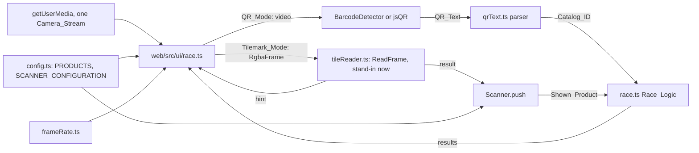
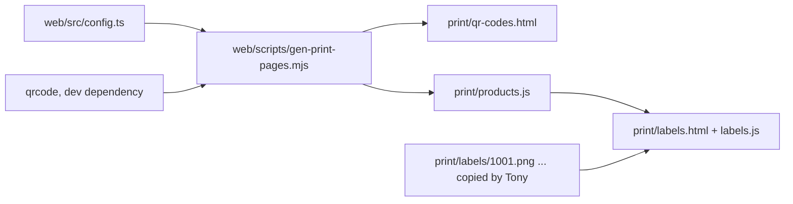

# Design Document: Race

## Overview

The race has three parts: the Race_Screen in `/web`, and two print pages in `/print`.

- **Race_Screen** `web/race/index.html` with the script `web/src/ui/race.ts`. It opens one rear Camera_Stream, runs a QR_Mode Run or a Tilemark_Mode Run on it, and shows both totals side by side. The timing and results rules are pure functions in `web/src/race/`, tested under Node with a fake clock.
- **QR_Sheet** `print/qr-codes.html`, generated by `web/scripts/gen-print-pages.mjs` from `web/src/config.ts` with the `qrcode` package.
- **Label_Sheets** `print/labels.html` with the classic script `print/labels.js`. It reads the product list from the generated `print/products.js` and the label images from `print/labels/<Product_ID>.png`, which Tony copies there.

The `tile-reader` spec is not built. The Race_Screen calls the Tile_Reader_Interface through `web/src/race/tileReader.ts`, which for now supplies the Stand_In_Reader. Task 7 wires the real Tile_Reader.

### Decisions in this design

| ID | Decision |
|---|---|
| D1 | Branch `web/race` is made from `web/scanner`, not from `master`, because `web/src/config.ts` and the Scanner exist only on `web/scanner` (not merged yet). Work happens in the worktree `D:\Coding\ShadowCode-wt\race`, because the main checkout is on `training/demo-pipeline`. |
| D2 | Race_Logic is immutable state plus pure functions (`createRace`, `start`, `productFound`, `reset`, `results`). Every function that needs the time takes `now` (a Run_Clock value in ms) as an argument. The UI passes `performance.now()`; tests pass values from a fake clock (Requirement 3.12). |
| D3 | One Mode runs at a time. `start` for a Mode is ignored while the other Mode has a Running_Run (3.3). `start` for a Mode that already has a Run replaces it, so a Mode can be re-run without clearing the other (3.2). |
| D4 | A Run finishes when every Catalog_ID has a Find. The catalog has 3 IDs, so that is "after three". Run_Total is the Find_Time of the last Find (3.9). |
| D5 | QR_Text_Parser accepts a text only if it equals `String(id)` for a Catalog_ID. This rejects spaces, signs, leading zeros and `0` without a regular expression (4.4, 4.5). |
| D6 | Tile_Reader_Interface: `type ReadFrame = (frame: RgbaFrame) => Promise<TileReadout>`. It is asynchronous because ONNX Runtime Web's `session.run` is. A `TileReaderSource` gives the Bundle_ID, whether it is a stand-in, and `createReader()`, which returns a fresh `ReadFrame` (empty 3-frame window) for each Tilemark_Mode Run (5.2). |
| D7 | A new Scanner per Tilemark_Mode Run (5.2). A product already found is reported again by the Scanner on later frames; Race_Logic ignores the repeat (3.5). |
| D8 | Frames are processed one at a time: the loop waits for the reader to return, then takes the next video frame (`requestVideoFrameCallback` where available, else `requestAnimationFrame`). Frames that arrive meanwhile are skipped and are not Decode_Attempts, as the Scanner spec counts them (5.1). |
| D9 | QR_Mode uses `BarcodeDetector` with `qr_code` on the video element where `getSupportedFormats()` lists `qr_code` (Chrome on Android). Elsewhere it uses jsQR on a copy of the frame shrunk so the short side is 540 px, with `inversionAttempts: 'dontInvert'`, to keep one jsQR call near the 100 ms target (4.2, 4.3). jsQR (130 kB) is loaded with a dynamic `import()` only when it is needed, so phones with `BarcodeDetector` do not download it. |
| D10 | Print pages are plain files opened from the file system (`file://`). They use no ES modules (blocked on `file://`), only classic scripts and inline SVG. The parts that need npm packages or `config.ts` are generated by `gen-print-pages.mjs` and committed. A test fails when the committed files differ from the generator's output (8.9). |
| D11 | The QR code is drawn as an SVG from the module matrix of `QRCode.create(text, { errorCorrectionLevel: 'M' })`, so its size is set in millimetres: QR_Symbol 42 mm wide, Quiet_Zone 4 modules. For the decimal IDs (version 1, 21 modules) a module is 2 mm and the code with its Quiet_Zone is 58 mm (8.4, 8.5). |
| D12 | Label_Sheets put two Labels per Sheet, turned 90 degrees, stacked (2 × 114 = 228 mm of the 297 mm). The Label element keeps its 114 × 149 mm size and is turned with a CSS `transform`, so its own CSS size stays 114 × 149 mm (9.2, 9.4). |
| D13 | The label-size check has two parts: a Vitest test in happy-dom that builds the Sheets with `print/labels.js` and checks every Label element's style is `114mm` × `149mm`; and an on-screen check in the page that measures each Label's `offsetWidth` and `offsetHeight` (sizes before the transform) against the 100 mm Ruler_Line (9.10). |
| D14 | Bundle_ID is a field of the `TileReaderSource`. The stand-in returns `20261126-ba0ab4d`; the real Tile_Reader returns `bundle_id` from `contract.json`, as `.kiro/steering/model-bundle.md` asks. |

## Architecture





### Files

| File | Role |
|---|---|
| `web/race/index.html` | Race_Screen page. Added to the Vite build inputs next to `measure/index.html`. |
| `web/src/ui/race.ts` | Camera, frame loops, rendering. The only file that uses DOM, camera or `performance`. |
| `web/src/race/race.ts` | Race_Logic and time formatting. |
| `web/src/race/qrText.ts` | QR_Text_Parser. |
| `web/src/race/frameRate.ts` | Frame_Rate counter. |
| `web/src/race/tileReader.ts` | `RgbaFrame`, `ReaderHint`, `TileReadout`, `ReadFrame`, `TileReaderSource`, the Stand_In_Reader and `TILE_READER_SOURCE` (the source in use). |
| `web/src/print/qrSheet.ts` | `qrSheetHtml(products)`, `qrMatrix(text)`, `productsScript(products)`. Pure; uses `qrcode`. |
| `web/scripts/gen-print-pages.mjs` | Writes `print/qr-codes.html` and `print/products.js`; `--check` exits 1 if they differ. Runs under Node 24 type stripping, importing `../src/config.ts` and `../src/print/qrSheet.ts` directly. |
| `print/qr-codes.html`, `print/products.js` | Generated, committed. |
| `print/labels.html`, `print/labels.js` | Label_Sheets page and its classic script. |
| `print/labels/README.md` | Where Tony puts `1001.png`, `1002.png`, `1003.png`. |
| `print/README.md` | How to print and regenerate. |
| `web/public/licenses/jsQR-LICENSE.txt` | Copy of `node_modules/jsqr/LICENSE`, served with the build (10.2). |

The modules in `web/src/race/` and `web/src/print/` import no UI module and use no `window`, `document`, `navigator`, `getUserMedia` or `performance` (11.1). `race.ts` and `qrText.ts` import nothing; `tileReader.ts` imports only the `DecodeResult` type.

## Components and Interfaces

### `race.ts`

```ts
export type Mode = 'qr' | 'tilemark'
export const MODES: readonly Mode[]                      // ['qr', 'tilemark']

export interface Find { readonly id: number; readonly ms: number }   // ms = Find_Time
export interface Run {
  readonly startedAt: number                              // Run_Clock ms
  readonly finds: readonly Find[]                         // in the order found
  readonly totalMs: number | null                         // Run_Total, null while running
}
export interface RaceState {
  readonly catalog: readonly number[]                     // Catalog_IDs, in display order
  readonly runs: Readonly<Record<Mode, Run | null>>
}

export function createRace(catalog: readonly number[]): RaceState
export function start(state: RaceState, mode: Mode, now: number): RaceState
export function productFound(state: RaceState, mode: Mode, id: number, now: number): RaceState
export function reset(state: RaceState): RaceState
export function isRunning(run: Run | null): boolean
export function runningMode(state: RaceState): Mode | null
export function elapsedMs(run: Run | null, now: number): number | null   // running: now - startedAt; finished: totalMs
export interface ResultRow { readonly id: number; readonly ms: Readonly<Record<Mode, number | null>> }
export interface Results {
  readonly rows: readonly ResultRow[]                     // one per Catalog_ID, catalog order
  readonly totals: Readonly<Record<Mode, number | null>>
  readonly differenceMs: number | null                    // QR total − Tilemark total, both finished only
  readonly faster: Mode | 'tie' | null
}
export function results(state: RaceState): Results
export function formatSeconds(ms: number | null): string  // "12.34 s", or "–" for null
```

Every function returns a new state or the same state object when the event is ignored, so the UI can skip a render with `next === state`.

`createRace` rejects a catalog with 0, duplicates or a non-integer with a `RangeError`, because Run finishing counts distinct IDs.

### `qrText.ts`

```ts
export function createQrTextParser(catalog: Iterable<number>): (text: string) => number | null
```

Builds a `Map<string, number>` from `String(id)` to `id` for each Catalog_ID except 0. The parser returns `map.get(text) ?? null`.

### `frameRate.ts`

```ts
export interface FrameRateCounter {
  record(now: number): void         // one Processed_Frame finished at now
  perSecond(now: number): number    // Processed_Frames in (now − 1000, now]
  reset(): void
}
export function createFrameRateCounter(windowMs?: number): FrameRateCounter   // default 1000
```

### `tileReader.ts`

```ts
import type { DecodeResult } from '../codec/message'

export interface RgbaFrame { readonly width: number; readonly height: number; readonly data: Uint8ClampedArray }
export type ReaderHint = 'show all four corners' | 'closer' | 'farther'
export interface TileReadout {
  readonly result: DecodeResult
  readonly hint: ReaderHint | null
  readonly missingTags?: readonly number[]    // with 'show all four corners'
}
export type ReadFrame = (frame: RgbaFrame) => Promise<TileReadout>
export interface TileReaderSource {
  readonly bundleId: string
  readonly standIn: boolean
  createReader(): Promise<ReadFrame>          // fresh window per Run
}
export const STAND_IN_BUNDLE_ID = '20261126-ba0ab4d'
export const standInReaderSource: TileReaderSource   // result null, hint null
export const TILE_READER_SOURCE: TileReaderSource    // the one the Race_Screen uses; standInReaderSource now
```

The Stand_In_Reader returns `{ result: null, hint: null }` and checks that `data.length === width * height * 4`, throwing a `RangeError` otherwise, so the frame capture is checked before the real reader exists. It never invents a product: in Tilemark_Mode with the stand-in, no product is found and the Race_Screen says "stand-in reader: Tilemark mode cannot find products yet" (5.7).

Task 7 replaces `TILE_READER_SOURCE` with a source built on the `tile-reader` spec's code. If that spec's function differs from `ReadFrame`, task 7 adds an adapter here; `race.ts` and `ui/race.ts` do not change.

### `ui/race.ts`

State: the `RaceState`, a run token (incremented by Start and Reset; a loop stops when its token is stale), the Scanner and `ReadFrame` of the current Tilemark_Mode Run, the Frame_Rate counter, the QR reader kind.

- **Camera** (2.1–2.5). On load: `getUserMedia({ audio: false, video: { facingMode: 'environment', width: { ideal: 1080 }, height: { ideal: 1920 } } })`. The stream is never stopped by the page. Start buttons are enabled on the video's `playing` event. The Debug_Line shows `videoWidth × videoHeight`.
- **Frame capture**. A canvas of the video's size with `willReadFrequently: true`; `drawImage(video)` then `getImageData` gives the RgbaFrame at its delivered size (5.1). The Tile_Reader shrinks frames whose short side is over 1080 px (tile-reader step 1).
- **QR loop**. While its Run is running: wait for a video frame; detect; for each QR_Text, parse; for each Catalog_ID, `productFound(state, 'qr', id, performance.now())`.
- **Tilemark loop**. While its Run is running: wait for a video frame; capture; `await read(frame)` (an error is shown and counts as `{ result: null, hint: null }`, 5.8); `frameRate.record(now)`; `scanner.push(result)`; show the hint (and missing tags); a non-null Shown_Product goes to `productFound(state, 'tilemark', id, now)`.
- **Display**. A `requestAnimationFrame` loop updates the running timer and, in Tilemark_Mode, the Frame_Rate (3.10, 7.2). Finds, totals and the difference are rendered from `results(state)` whenever the state changes (3.11, 6.1–6.3).
- **Reset** clears the state, increments the token (stops both loops) and clears hint, error and Frame_Rate (6.4).

`BarcodeDetector` is not in TypeScript's DOM library; `ui/race.ts` declares the small part it uses.

Layout, portrait phone: video preview on top (object-fit contain), then the big running timer and the Mode name, the hint line, three buttons (Start QR, Start Tilemark, Reset), the results table (Product, QR, Tilemark; a Total row), the difference line, and the Debug_Line in small grey text: `bundle 20261126-ba0ab4d (stand-in reader) · 0.0 frames/s · stream 1080×1920 · QR: BarcodeDetector`.

### Print pages

**QR_Sheet** (Requirement 8). A4 portrait, `@page { size: A4; margin: 0 }`. A column of three cells, each 80 mm wide and 85 mm high, centred, with a dashed 0.3 mm border as the cut line. A cell holds the 58 mm SVG (42 mm QR_Symbol and 8 mm Quiet_Zone on each side) and, under it, the Product_Name and `ID 1001`. Each SVG carries `data-text`, `data-modules` and `data-module-mm`, so the test reads the sizes from the file. The cut line is 11 mm from the code on each side, outside the Quiet_Zone (8.7).

**Label_Sheets** (Requirement 9). `@page { size: A4; margin: 0 }`. A Sheet is a 210 × 297 mm box (`break-after: page`). Slot positions in mm from the Sheet's top-left:

| Item | Left | Top | Width | Height |
|---|---|---|---|---|
| Slot 1 (Label turned 90°) | 30.5 | 12 | 149 | 114 |
| Caption 1 | 30.5 | 127 | 149 | 5 |
| Slot 2 | 30.5 | 136 | 149 | 114 |
| Caption 2 | 30.5 | 251 | 149 | 5 |
| Ruler_Line (100 mm, ticks every 10 mm, SVG) | 55 | 262 | 100 | 8 |
| "print at 100% (actual size)" | 0 | 274 | 210 | 6 |

All printed content is at least 8 mm from the paper edges, clear of usual printer margins. Lines and outlines are SVG strokes or CSS borders, which print with "background graphics" off.

`labels.js` exposes `TilemarkLabels` on `globalThis`:

```js
LABEL_W_MM = 114, LABEL_H_MM = 149, DEFAULT_COPIES = 6, MAX_COPIES = 60
clampCopies(value) -> integer in [0, 60]            // non-numbers -> 6
planSheets(entries)  // entries [{ id, copies }] -> sheets [[{ id, copy, of }], ...], 2 per sheet, product order, copy order
renderSheets(doc, container, plan, available)       // available: Set of IDs whose image loaded
checkSizes(doc, container) -> { ok, count, bad: [...] }   // offsetWidth/Height against the 100 mm ruler
init(doc, products)                                  // inputs, image probes, render, check
```

`init` runs only when `document` and `TILEMARK_PRODUCTS` exist, so the test can load the file without side effects. For each product it loads `labels/<id>.png` once with an `Image`; on `error` the product's Labels become outlines (9.8). On `load` it also shows the image's px per mm (`naturalWidth / 114`) in the on-screen check, so a wrong file is noticed. Controls and the check are in a `.screen-only` block hidden by `@media print`.

## Dependencies and licensing

| Package | Version | License | Use | Kind |
|---|---|---|---|---|
| `jsqr` | 1.4.0 | Apache-2.0 | QR reading where `BarcodeDetector` has no `qr_code` | runtime |
| `qrcode` | 1.5.4 | MIT | QR module matrix for the QR_Sheet (generator only) | dev |
| `@types/qrcode` | 1.5.6 | MIT | types for `qrcode` | dev |
| `happy-dom` | 21.x | MIT | DOM for the Label_Sheets test | dev |

jsQR is listed under the "All dependencies must be MIT-compatible" rule of `.kiro/steering/tech.md` as a permissive dependency. Apache-2.0 is a permissive, free license; code under it can be bundled into an MIT-licensed app. The app's own code stays MIT. Its condition is that redistribution keeps the license text and notices: `web/public/licenses/jsQR-LICENSE.txt` is a copy of `node_modules/jsqr/LICENSE` and ships in `dist/licenses/`, and a test checks the copy equals the package's file. jsQR has no NOTICE file. `qrcode`'s dependencies (`dijkstrajs`, `pngjs`, `yargs`) are MIT and dev-only.

## Error Handling

| Situation | Behaviour |
|---|---|
| `navigator.mediaDevices.getUserMedia` missing | Error line: "getUserMedia is not available. The page must be served over HTTPS or from localhost." Start buttons stay disabled. |
| `getUserMedia` rejects | Error line with the error's name and message. Start buttons stay disabled. |
| `BarcodeDetector.detect` rejects | Error line; the QR loop switches to jsQR for the rest of the page's life. |
| `ReadFrame` rejects or throws | Error line with the message; the frame counts as `{ result: null, hint: null }`; the loop goes on (5.8). |
| `createRace` with 0, a duplicate or a non-integer ID | `RangeError`. |
| `start` while the other Mode is running; `productFound` for a non-Catalog_ID, a Mode without a Running_Run, or a repeat | Same state returned. |
| Label image missing | Outline with the Product_ID (9.8). |
| Generated print file out of date | `gen-print-pages.mjs --check` exits 1; the Vitest golden test fails with the file name. |

## Correctness Properties

*A property is a characteristic or behavior that should hold true across all valid executions of a system, a formal statement about what the system should do. Properties bridge the human-readable specification and machine-checked tests.*

Reflection on redundancy: 3.4, 3.5 and 3.6 are one rule (the first report of each Catalog_ID counts, in any order); Property 1 covers them with the reference model. 3.7 and 3.8 (ignored events) are covered by Property 2. 3.9 and 6.1 are Property 3. UI criteria (2.x, 3.10, 3.11, 4.1–4.3, 4.6, 4.7, 5.x, 7.2) are checked by hand on the phone (task 8), because they need a camera.

### Property 1: Finds equal the reference model

*For any* sequence of events (start of either Mode, a found report of any Product_ID for either Mode, reset) with non-decreasing times, the Finds of each Mode's Run equal a reference computed from the events alone: after the Run's last start, the first report of each Catalog_ID, while the Run was running, with Find_Time = report time − start time.

**Validates: Requirements 3.1, 3.2, 3.4, 3.5, 3.6**

### Property 2: Ignored events change nothing

*For any* reachable state, `productFound` with a non-Catalog_ID, for a Mode without a Running_Run, or for a Catalog_ID already found, and `start` for a Mode while the other Mode is running, return the same state object.

**Validates: Requirements 3.3, 3.5, 3.7, 3.8**

### Property 3: A Run finishes exactly when all Catalog_IDs are found

*For any* event sequence, a Run has `totalMs !== null` if and only if it has a Find for every Catalog_ID, and then `totalMs` is the largest Find_Time; `results` gives that value as the Mode's total and, when both are finished, `differenceMs = totals.qr − totals.tilemark`.

**Validates: Requirements 3.9, 6.1, 6.3**

### Property 4: The QR_Text_Parser accepts exactly the catalog's decimal texts

*For any* string, the parser returns a Catalog_ID `c` if and only if the string is `String(c)`; otherwise `null`. Strings are drawn from arbitrary unicode, digit strings, catalog texts with a character added or removed, and padded catalog texts.

**Validates: Requirements 4.4, 4.5**

### Property 5: Sheet plan keeps every copy, two per Sheet

*For any* list of products with Copies in [0, 60], `planSheets` gives Σ Copies Labels in product order and copy order, every Sheet has 2 Labels except possibly the last, which has 1 exactly when Σ Copies is odd, and no Sheet is empty.

**Validates: Requirements 9.4, 9.5, 9.6**

## Testing Strategy

| File | Contents |
|---|---|
| `web/src/race/__tests__/race.unit.test.ts` | With a fake clock (`{ now, advance(ms) }`): start; Find_Time; duplicate ignored; any order; non-catalog ignored; found before start ignored; finish after three and Run_Total; found after finish ignored; replace a Run; other Mode blocked while running; reset; `elapsedMs`; `results` rows, totals, difference and faster; `formatSeconds`; `createRace` errors. |
| `web/src/race/__tests__/race.properties.test.ts` | Properties 1–3. |
| `web/src/race/__tests__/qrText.test.ts` | `1001`, `1002`, `1003` accepted; `1004`, `0`, ` 1001x`, empty, `01001`, `+1001`, `1001 `, `1001.0` ignored; Property 4. |
| `web/src/race/__tests__/frameRate.test.ts` | Counts frames in the last 1000 ms; a frame exactly 1000 ms old drops out; reset. |
| `web/src/race/__tests__/tileReader.test.ts` | Stand-in returns `{ result: null, hint: null }`, rejects a wrong data length, gives a fresh function per `createReader`; `TILE_READER_SOURCE.bundleId` is `20261126-ba0ab4d`. |
| `web/src/race/__tests__/race.isolation.test.ts` | The `web/src/race/` and `web/src/print/` modules have no UI imports and no browser APIs; `race.ts`, `qrText.ts`, `frameRate.ts` and `ui/race.ts` hold no Product_Name text (1.4). |
| `web/src/print/__tests__/qrSheet.test.ts` | Each code's matrix, drawn to pixels, decodes with jsQR to `1001`, `1002`, `1003`; module count × module size ≥ 30 mm; Quiet_Zone 4 modules; name and ID under each; three cut-line cells; the committed `print/qr-codes.html` and `print/products.js` equal the generator output (line endings ignored). |
| `web/src/print/__tests__/labels.test.ts` | happy-dom: load `print/labels.js`; Property 5; `clampCopies`; with 6 copies each, 9 Sheets of 2; each Label element `114mm` × `149mm` in its style, no `px` size; a product not in `available` gets outlines of the same size with its ID; every Sheet has a 100 mm ruler and the text "print at 100% (actual size)"; `labels.html` declares `@page { size: A4` and loads `products.js` and `labels.js`. |
| `web/src/race/__tests__/licenses.test.ts` | `web/public/licenses/jsQR-LICENSE.txt` equals `node_modules/jsqr/LICENSE`. |

Property tests: `FC_SEED = 0x7ace2026`, 1,000 runs each, tag comment `// Feature: race, Property {n}: {title}`.

Printed check (9.10, D13): open `print/labels.html` from the file system in Edge; the on-screen check line must read "all N labels measure 114 × 149 mm". Task 6 runs it headless (`msedge --headless --dump-dom`) and records the result.

Hand check on the phone (task 8): both Modes start, the timer runs, QR_Mode finds the three QR_Sheet codes and stops, Tilemark_Mode shows the stand-in note, Reset clears.

## Open Items

- Task 7: wire the real Tile_Reader when the `tile-reader` spec is built.
- Task 8: the hand check on a phone needs Tony and the printed QR_Sheet.
