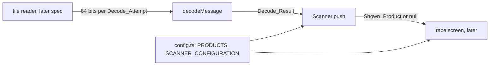

# Design Document: Scanner

## Overview

The Scanner is a pure TypeScript module, `/web/src/scanner/scanner.ts`. It takes one Decode_Result per Decode_Attempt and returns the Shown_Product for that Decode_Attempt, or `null`. A Decode_Result is the return value of `decodeMessage` in `/web/src/codec/message.ts`: `{ id, correctedBits }` or `null`. The Scanner has no camera, DOM, timer or frame input. It sees only the sequence of Decode_Results, so consecutiveness is counted over Decode_Attempts (Requirement 2.8).

The app's configuration lives in one module, `/web/src/config.ts`. It holds the Product_Catalog (IDs 1001, 1002, 1003 with display names) and the Confirmation_Count 2. The race screen (a later UI task) and the code that creates the Scanner both import it, so the product names exist in one place only.

The tile reader (later spec `tile-reader`) produces the Decode_Results. It decodes the average of the reader's logits over the last 3 frames (`reading.frames_averaged` in the bundle's `contract.json`, `docs/model-contract.md`, "How to read a scan"), one Decode_Result after every processed frame (sliding window, D8). Consecutive Decode_Attempts therefore share frames and are not independent. The section "Frame windows and the independence argument" works out what this does to Requirement 2's argument and to timing. The Scanner code does not depend on the schedule.

### Decisions in this design

| ID | Decision |
|---|---|
| D1 | The Scanner is a factory `createScanner(config)` that returns an object with `push(result)`. State is per instance, so two scanners never share a Candidate_ID. |
| D2 | `push` returns the Shown_Product (a Product_ID) or `null` for every Decode_Attempt. While the Match_Run stays at or above N, every further matching Decode_Attempt returns the ID again (Requirement 2.3 says "greater than or equal"). |
| D3 | Configuration is validated once, in `createScanner`. An invalid or missing Confirmation_Count throws a `RangeError`, so no Scanner object exists and no Decode_Attempt can be processed (Requirement 3.3, 3.4). There is no default value. |
| D4 | `ScannerConfiguration.confirmationCount` is typed `2 \| 3`. The runtime check still runs, because configuration can come from untyped code. |
| D5 | The Product_Catalog is passed to the Scanner as a `ReadonlySet<number>` of Product_IDs. Display names stay in `/web/src/config.ts` and are not part of the Scanner. |
| D6 | The Reserved_ID 0 is rejected before the catalog lookup, so a catalog that contains 0 by mistake still never shows it (Requirement 1.3). |
| D7 | The documentation items of Requirements 1.6, 2.12, 2.13, 3.5, 3.6 and 4.3 are written in a comment block at the top of `scanner.ts`. The window analysis, which needs tables, stays in this design. |
| D8 | Sliding window with Confirmation_Count 2, chosen by Tony on 2026-11-28. The tile reader gives one Decode_Result after every processed frame, from the first frame of a scan, averaging 1, then 2, then 3 frames. Least successful read: 2 frames, 200 ms at 100 ms per frame (see "Frame windows and the independence argument"). |

## Architecture



`/web/src/scanner/scanner.ts` imports only the `DecodeResult` type from `/web/src/codec/message.ts`. `/web/src/config.ts` imports only the `ScannerConfiguration` type from the Scanner. Neither file imports UI modules or uses `window`, `document`, `navigator` or `getUserMedia`. Both run in Vitest under Node.

### State machine

State: `candidateId` (a Catalog_ID or `null`) and `matchRun` (an integer ≥ 0). `matchRun` is 0 exactly when `candidateId` is `null`.

For each Decode_Result `r`:

1. If `r` is `null`: set `candidateId = null`, `matchRun = 0`, return `null` (2.6).
2. Let `id = r.id`. `correctedBits` is not read (1.5, 2.9).
3. If `id === 0` or `!catalog.has(id)`: set `candidateId = null`, `matchRun = 0`, return `null` (1.2, 1.3, 2.7).
4. If `id === candidateId`: `matchRun += 1` (2.2). Otherwise: `candidateId = id`, `matchRun = 1` (2.1, 2.5).
5. Return `id` if `matchRun >= N` (2.3), else `null` (2.4).

`matchRun` is not capped, because Requirement 2.2 says it increases by 1. A JavaScript number counts exactly up to 2^53, far beyond any scan.

## Components and Interfaces

### `scanner.ts` (public)

```ts
import type { DecodeResult } from '../codec/message'

export const CONFIRMATION_COUNT_MIN = 2
export const CONFIRMATION_COUNT_MAX = 3

export interface ScannerConfiguration {
  /** Product_IDs that exist as products. The Scanner only tests membership. */
  readonly productCatalog: ReadonlySet<number>
  /** N: consecutive Decode_Attempts with the same Catalog_ID before it is shown. Only 2 or 3. No default. */
  readonly confirmationCount: 2 | 3
}

export interface ScannerState {
  readonly candidateId: number | null
  readonly matchRun: number
}

export interface Scanner {
  /** Process one Decode_Attempt. Returns the Shown_Product, or null. */
  push(result: DecodeResult): number | null
  /** Current Candidate_ID and Match_Run, for tests and the debug view. */
  state(): ScannerState
}

export function createScanner(config: ScannerConfiguration): Scanner
```

### `config.ts` (app configuration)

```ts
export interface Product { readonly id: number; readonly name: string }
export const PRODUCTS: readonly Product[]                 // 1001, 1002, 1003; names "Product 1001" etc.
export const SCANNER_CONFIGURATION: ScannerConfiguration  // catalog = IDs of PRODUCTS, confirmationCount 2
export function productName(id: number): string | undefined
```

`PRODUCTS` and its entries are frozen. Tony replaces the names in this one array.

## Error Handling

| Input to `createScanner` | Result |
|---|---|
| `confirmationCount` absent or `undefined` | `RangeError`: `Scanner_Configuration: Confirmation_Count is missing; supply an integer in [2, 3] (the app uses 2)` |
| `confirmationCount` not an integer in [2, 3]: 0, 1, 4, −1, 2.5, `NaN`, ±`Infinity`, `'2'`, `null`, any non-number | `RangeError`: `Scanner_Configuration: Confirmation_Count must be an integer in [2, 3], got <value>`. Strings are shown in quotes. |
| `config` itself `null` or not an object | `TypeError`: `Scanner_Configuration is missing` |

Both messages contain the text `Confirmation_Count`; the invalid-value message also contains `[2, 3]` (3.3), and the missing-value message contains `missing` (3.4). `push` never throws for a value of type `DecodeResult`.

## Frame windows and the independence argument

Decision (D8, Tony, 2026-11-28): sliding window, Confirmation_Count 2. The tile reader gives the Scanner one Decode_Result after every processed frame. It starts at the first frame of a scan and averages the logits of however many frames the window holds: 1, then 2, then 3, after which the window slides.

### What averaging does to Requirement 2's argument

The measured rates in the Residual_Risk_Section (2.9 × 10⁻⁴ under heavy corruption, 0.031% on random input) are single-decode rates on independent draws. Multiplying them over N Decode_Attempts is valid only if those Decode_Attempts are independent.

Under the sliding window they are not. Decode_Attempt k averages frames max(1, k−2) … k. From the third frame on, Decode_Attempt k and k+1 share 2 of their 3 frames; at the start, Decode_Attempt 2 (frames 1–2) contains all of Decode_Attempt 1 (frame 1). A wrong read that comes from the shared frames (one strongly wrong frame, or two frames of a tile-free area) tends to produce the same bits, and so the same wrong ID, in consecutive Decode_Attempts. One bad frame stays in up to 3 consecutive windows. Confirmation with N = 2 therefore removes a wrong read that lasts one Decode_Attempt, but not one caused by frames that two consecutive windows share. In that case it protects no better than one decode.

Separate windows (frames 1–3, then 4–6, …), the option not chosen, share no frames, but a hand-held camera looking at the same wrong spot still gives similar windows. So independence is an approximation in either schedule.

The catalog check is the main protection, and it does not depend on independence. A false accept returns an arbitrary 32-bit ID. If such IDs are spread evenly over 2^32 values (an assumption; it is not measured), the chance that one lands on one of the 3 catalog IDs is 3 / 2^32 ≈ 7.0 × 10⁻¹⁰. Per Decode_Attempt that gives about 2.9 × 10⁻⁴ × 7.0 × 10⁻¹⁰ ≈ 2.0 × 10⁻¹³ (heavy corruption) and 3.1 × 10⁻⁴ × 7.0 × 10⁻¹⁰ ≈ 2.2 × 10⁻¹³ (random input), before any confirmation. How often two consecutive Decode_Attempts return the same wrong ID on averaged logits has not been measured. The photo fixture set (`training/export/demo-fixtures/photos/`) could measure it.

### Timing of the two schedules

Assumptions: each processed frame costs up to 100 ms (locate, flatten, reader inference; the message decode itself measured 0.003 ms), which is the per-attempt target in `.kiro/steering/tech.md`. Every Decode_Attempt in the run returns the right ID. The numbers are the least possible; misses add frames. The successful-read target is under 500 ms.

| Schedule | Decode_Attempts at frame | Least frames for N = 2 | Time at 100 ms per frame | Least frames for N = 3 | Time at 100 ms per frame |
|---|---|---|---|---|---|
| Sliding window from the first frame (chosen): decode after every frame, window of 1, 2, then 3 frames | 1, 2, 3, … | 2 (= N) | 200 ms, meets 500 ms | 3 | 300 ms, meets 500 ms |
| Separate windows (not chosen): decode once per 3 new frames | 3, 6, 9, … | 6 (= 3N) | 600 ms, misses 500 ms | 9 | 900 ms, misses 500 ms |

With the chosen schedule and N = 2, the least successful read is 2 frames: Decode_Attempt 1 on frame 1 alone, Decode_Attempt 2 on the average of frames 1 and 2. That is 200 ms at 100 ms per frame. It stays under 500 ms while a frame takes less than 250 ms. If processing is faster than the camera (33 ms per frame at 30 fps), the camera rate sets the time: about 67 ms.

The 2-frame minimum uses windows of 1 and 2 frames. `docs/model-contract.md` ("How to read a scan") says one frame alone reads worse than the 3-frame average the pass line was measured on. When the early windows return `null` or disagree, the read goes on with full 3-frame windows, and every extra frame adds 100 ms. At 100 ms per frame a read can use at most 4 frames (400 ms); 5 frames take 500 ms and miss "under 500 ms".

### Effect on this spec

The Scanner code is the same for both schedules: it counts Decode_Attempts and has no frame input (Requirement 2.8). The decision changed the reason wording in the requirements introduction and in Requirement 4 (no acceptance criterion changed), design D8, and one paragraph of the comment block in `scanner.ts`. The schedule itself is built in the tile-reader spec.

## Correctness Properties

*A property is a characteristic or behavior that should hold true across all valid executions of a system, a formal statement about what the system should do. Properties bridge the human-readable specification and machine-checked tests.*

Reflection on redundancy: 1.4 and 4.1(a) are the same statement; 2.10 and 4.1(b) are the same statement for N = 2. 2.1, 2.2, 2.5, 2.6 and 2.7 are state transitions, covered together by the reference-model property and one unit test each. 2.8 has no frame input to vary, so it is a unit test. The documentation criteria (1.6, 2.12, 2.13, 3.5, 3.6, 4.3) are checked by a test that reads the comment block.

### Property 1: Only catalog IDs are shown, never the Reserved_ID

*For any* N ∈ {2, 3}, any Product_Catalog (which may contain 0) and any sequence of Decode_Results, every non-null value returned by `push` is contained in the Product_Catalog and is not 0.

**Validates: Requirements 1.2, 1.3, 1.4, 4.1**

### Property 2: Shown only after N consecutive equal Catalog_IDs

*For any* N ∈ {2, 3}, Product_Catalog and sequence of Decode_Results, if `push` returns `p` at Decode_Attempt i, then i ≥ N − 1 (0-based) and Decode_Attempts i − N + 1 … i all returned non-null Decode_Results with Decoded_ID `p`, and `p` is a Catalog_ID.

**Validates: Requirements 2.3, 2.4, 2.10, 4.1**

### Property 3: N consecutive equal Catalog_IDs are shown at the Nth

*For any* N ∈ {2, 3}, any prefix sequence that ends with no Candidate_ID held (empty, or ending in `null` or a non-Catalog_ID), and any Catalog_ID `c` with any `correctedBits` values, pushing `c` N times after the prefix returns `null` for the first N − 1 and `c` for the Nth.

**Validates: Requirements 1.1, 2.1, 2.2, 2.3, 2.11**

### Property 4: `correctedBits` is ignored

*For any* N, Product_Catalog and sequence of Decode_Results, replacing every `correctedBits` with an arbitrary other integer gives the same sequence of return values and states.

**Validates: Requirements 1.5, 2.9**

### Property 5: Agreement with the reference model

*For any* N, Product_Catalog and sequence of Decode_Results, after each Decode_Attempt `state()` equals a reference computed from the sequence alone: `candidateId` is the last Decoded_ID if it is a Catalog_ID, else `null`; `matchRun` is the length of the trailing run of that Catalog_ID, or 0.

**Validates: Requirements 2.1, 2.2, 2.5, 2.6, 2.7**

### Property 6: Only 2 and 3 are accepted as Confirmation_Count

*For any* value `v` (fast-check `anything`, plus numbers) other than 2 and 3, `createScanner` with `confirmationCount: v` throws a `RangeError` whose message names `Confirmation_Count`; with 2 or 3 it returns a Scanner.

**Validates: Requirements 3.1, 3.2, 3.3**

## Testing Strategy

### Test files

| File | Contents |
|---|---|
| `/web/src/scanner/__tests__/scanner.unit.test.ts` | One or more example tests per acceptance criterion of Requirements 1, 2 and 4, named with the criterion number. 2.8: pushes separated by `vi.advanceTimersByTime(10_000)` still confirm. |
| `/web/src/scanner/__tests__/scanner.properties.test.ts` | Properties 1–5, each run for N = 2 and N = 3. |
| `/web/src/scanner/__tests__/scanner.config.test.ts` | 3.3 and 3.4 for 0, 1, 4, −1, 2.5, `NaN`, `Infinity`, `-Infinity`, `'2'`, `null`, absent and explicit `undefined`; 2 and 3 accepted; Property 6. |
| `/web/src/scanner/__tests__/scanner.docs.test.ts` | The comment block at the top of `scanner.ts` contains `2.9 × 10⁻⁴`, `0.031%`, `Residual risk`, `500 ms`, `[2, 3]` and the chosen value 2. |
| `/web/src/scanner/__tests__/scanner.isolation.test.ts` | `scanner.ts` and `config.ts` import only the codec type and each other, and use no browser APIs. |
| `/web/src/__tests__/config.test.ts` | The app configuration holds exactly 1001, 1002, 1003 with names "Product 1001"–"Product 1003", Confirmation_Count 2, and `createScanner(SCANNER_CONFIGURATION)` succeeds (4.2). |

### Property test configuration

- `fc.assert(fc.property(...), { seed: FC_SEED, numRuns: 2000 })`, `FC_SEED = 0x5ca77e12`, printed at the start of each property. N comes from `fc.constantFrom(2, 3)`, and Properties 1–5 also run once each with N fixed at 2 and at 3 through `describe.each`.
- Catalog: 1 to 5 unique IDs from `fc.integer({ min: 0, max: 0xFFFFFFFF })`, with 0 added in about one run in four.
- Decode_Result generator: `null`, a catalog ID, 0, or any 32-bit ID, with `correctedBits` in 0–4. Catalog IDs are drawn from a small set so that runs of equal IDs are common. Sequences have 0 to 60 entries.
- Tag comment above each test: `// Feature: scanner, Property {n}: {title}`.

## Open Items

None. D8 was decided on 2026-11-28 (sliding window, Confirmation_Count 2), and the reason wording in requirements.md was changed as Tony asked.
