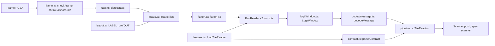

# Design Document: Tile Reader
## Overview
The Tile_Reader lives in `/web/src/reader/`. It turns one Frame into a Decode_Result and a Reader_Hint. All image steps are pure functions on `{ width, height, data }` RGBA pixels. The model run is passed in as a function (`RunReader`), so the frame pipeline runs in Vitest under Node with the real model (onnxruntime-web wasm) or with a stand-in.
Steps per Processed_Frame:
1. Check the Frame; shrink it by area averaging when its short side is over the Stream_Short_Side (1080).
2. Find Tags 0 to 3 (js-aruco2, AprilTag 36h11), refine each Tag's corners to a fraction of a pixel, take each Tag_Centre as the mean of its corners.
3. If a Tag is missing: Decode_Result `null`, hint `show all four corners`, missing IDs. If all four are missing, empty the Logit_Window.
4. Label_Homography from the Tag_Centres in label mm to frame pixels; Flatten_Corners of the two Whole_Tiles; Px_Per_Tile; hint `closer` or `farther` outside the Trained_Range.
5. Flatten each Whole_Tile to TILE_PX x TILE_PX without rounding; run the reader on each; Frame_Logits = mean of the two Tile_Logits.
6. Push the Frame_Logits into the Logit_Window (at most Window_Size); bits = mean logit > 0; `decodeMessage`.
The Scanner gets one Decode_Result after every Processed_Frame (scanner design D8: sliding window, from the first frame).
### Decisions in this design
| ID | Decision |
|---|---|
| D1 | Tag detector: js-aruco2 2.0.0 (MIT). It ships `src/dictionaries/apriltag_36h11.js` (587 codes from the AprilTag project's `Tag36h11.java`, BSD-2-Clause, MIT-compatible). OpenCV.js was not chosen: it is about 10 MB, and the `@techstark/opencv-js` package is Apache-2.0, not needed when a pure-JS detector works. The three files used (`cv.js`, `aruco.js`, `apriltag_36h11.js`) are vendored in `web/src/reader/vendor/js-aruco2/` with the package's `LICENSE.txt`. The only change is their module lines: the package is CommonJS and reads `this.CV` and `this.AR` at the top level, which is `undefined` in the Vite bundle (checked in Edge: `TypeError: Cannot read properties of undefined (reading 'CV')`). The vendored files use `import` and `export` instead and are otherwise byte-identical. |
| D2 | js-aruco2 gives corners as whole contour pixel indices (the boundary pixels of the black square, no sub-pixel step). The index q is converted to the Pixel_Convention as q + 0.5. Each corner is then refined: along 24 normals per side, the place where the luminance crosses halfway between black border and white margin is found by bilinear sampling, a line is fitted to each side (total least squares), and the corners are the intersections of adjacent lines (two passes). Measured on the 9 synthetic frames: Flatten_Corners within 0.31 px of the Reference_Scanner's, largest mean offset 0.22 px (frame 03, y). Without the + 0.5 the offset would be a constant 0.5 px. |
| D3 | Detection runs on a half-size area-averaged copy (540 x 960 for the stream) for speed. If any wanted Tag is missing there, it runs again on the full Frame. The refinement always uses the full Frame. At 231 px per tile a Tag is 65 px wide in the frame, 32 px in the half-size copy (4 px per cell). |
| D4 | js-aruco2 accepts a code within `maxHammingDistance − 1` bits. The default for 36h11 would accept 10 wrong bits of 36; the reader sets 5 (up to 4 wrong bits). 36h11 codes differ in at least 11 bits, so a wrong ID needs at least 7 wrong bits. |
| D5 | The Label_Layout is one frozen object, `LABEL_LAYOUT` in `layout.ts`. A test compares it with every product's `label.json` in every Fixture_Set (Requirement 4.2). |
| D6 | `homography` and `flatten` are the contract's JavaScript code, typed, unchanged in arithmetic (`docs/model-contract.md`, "What the reader is given"). |
| D7 | `parseContract` validates the Contract once at load and returns a typed object; no model number is typed into the reader code (Requirement 1.2). The pipeline reads TILE_PX, MESSAGE_BITS, the Trained_Range, the Stream_Short_Side and the Window_Size from it. |
| D8 | Window rule: a Read pushes its Frame_Logits; a frame with none of the four Tags empties the window; a frame with one to three Tags leaves it unchanged and returns `null`. This follows the request: "Empty the window when a frame finds none of the four tags". A partly covered label is often the same scan, so its earlier frames are kept. |
| D9 | One Decode_Result per Processed_Frame (scanner D8). A frame that is not a Read returns `null`, which clears the Scanner's Candidate_ID (scanner 2.6). |
| D10 | The reader instance is `ReadFrame = (frame) => Promise<TileReadout>`, the shape of the race spec's Tile_Reader_Interface (`web/src/race/tileReader.ts` on `web/race`). `types.ts` repeats the types structurally, so this branch does not depend on `web/race`; race task 8 can assign the reader without an adapter. `TileReadout.detail` adds corners, Px_Per_Tile, logits and timings for tests and a debug view; extra fields do not break the race type. |
| D11 | ONNX Runtime Web 1.31.1 (MIT), the version `docs/model-contract.md` measured. In the browser, `executionProviders: ['webgpu', 'wasm']`; WebGL is never listed. The default `onnxruntime-web` import in a browser loads `ort-wasm-simd-threaded.jsep.wasm`; `browser.ts` imports that file with Vite's `?url` and sets `ort.env.wasm.wasmPaths = { wasm: <absolute URL> }`, made absolute with `new URL(url, import.meta.url)` (Requirement 8.2). Node uses `ort.node.min.mjs` and finds its wasm itself. Checked 2026-11-28 in headless Edge on this laptop, with a temporary page (deleted afterwards) that loaded the bundle through `loadTileReader` and read the synthetic frames of 1001 and 1003 in order, in Vite dev and in a production build: every frame decoded to its product. |
| D12 | Fixture logits. Measured 2026-11-28: the Fixtures' tile `logits` are the reader's output on the frame flattened with the tile's `corners` without rounding (largest difference 4 × 10⁻⁵ of L over 18 tiles). On the 8-bit patch files the difference is 0.37% to 1.15% of L, bits identical. So Requirement 10.6 checks L / 1000 on the unrounded flatten and L / 50 plus identical bits on the patch file; 10.7 checks L / 1000 on the bundle's own `fixtures/`, whose logits do come from the patch (measured 1.2 × 10⁻⁶ of L). |
| D14 | Tests are split (Tony, 2026-11-28). `npm test` (`vitest.config.ts`) excludes `**/*.fixtures.test.ts` and passes on a clean checkout: it needs only the committed `contract.json` and `reader.onnx`. `npm run test:fixtures` (`vitest.fixtures.config.ts`, 120 s test timeout) runs the `*.fixtures.test.ts` files, which need the demo fixtures, the source bundle or the copy's `fixtures/`, and fail with the path when one is missing. The Pages workflow runs `npm test` only. |
| D15 | Execution provider in use. `loadTileReader` creates the session with one provider at a time, in the order given (default `webgpu`, then `wasm`), and keeps the first whose session runs one blank input; the source reports it as `executionProvider` (Requirement 8.4). The blank run also makes WebGPU compile its shaders during loading instead of on the first timed frame (measured before: 200 to 2,309 ms on frame 1). |
| D13 | Bundle copy: `web/scripts/copy-bundle.mjs` copies `TILEMARK_BUNDLE_SRC` (default `../training/export/20261126-ba0ab4d` from `/web`) to `web/public/models/20261126-ba0ab4d/` byte for byte and checks the sha256 of `reader.onnx` against the Contract. It never writes the source. Tony decided on 2026-11-28: `contract.json` and `reader.onnx` (8.3 MB) are committed; `web/public/models/*/fixtures/` is git-ignored (`.gitignore`), so it is never committed or deployed, and `npm run copy-bundle` puts it back for the fixture tests. |
## Architecture

### Files
| File | Contents | Imports |
|---|---|---|
| `types.ts` | `RgbaFrame`, `Point`, `Quad`, `ReaderHint`, `TileReadout`, `ReadDetail`, `ReadFrame`, `RunReader` | codec type only |
| `contract.ts` | `ReaderContract`, `parseContract(json)` | codec `MESSAGE_BITS` |
| `frame.ts` | `checkFrame`, `areaResize`, `shrinkToShortSide` | types |
| `tags.ts` | `detectTags`, `refineCorners`, `meanPoint` | `vendor/js-aruco2`, frame |
| `layout.ts` | `LABEL_LAYOUT`, `TAG_IDS`, `tileCornersMm` | types |
| `homography.ts` | `homography`, `project` | types |
| `locate.ts` | `locateTiles`, `meanSide` | homography, layout |
| `flatten.ts` | `flatten`, `imageToInput` | homography |
| `logitWindow.ts` | `LogitWindow`, `meanOf`, `logitsToBits` | none |
| `pipeline.ts` | `createFrameReader({ contract, runReader, layout? })` | all of the above, codec |
| `onnx.ts` | `createOnnxRunReader(ort, session, contract)` | `onnxruntime-web` types only |
| `browser.ts` | `loadTileReader(baseUrl, { executionProviders? })` | `onnxruntime-web`, the jsep wasm `?url`, `fetch` |
| `vendor/js-aruco2/` | `cv.js`, `aruco.js`, `apriltag_36h11.js` (ES modules), their `.d.ts` files, `LICENSE.txt` | each other |
Only `browser.ts` uses browser APIs (`fetch`, and ORT's browser build). Every other file runs in Node; an isolation test checks that none of them imports `/ui/` or uses `window`, `document`, `navigator`, `getUserMedia`.
## Components and Interfaces
```ts
// contract.ts
export interface ReaderContract {
  readonly bundleId: string
  readonly tilePx: number            // TILE_PX
  readonly messageBits: number       // MESSAGE_BITS
  readonly trainedPxPerTile: readonly [number, number]
  readonly streamShortSide: number   // min(camera.stream_px)
  readonly framesAveraged: number    // reading.frames_averaged
  readonly flatten: FlattenSpec      // target_size, target_corners
  readonly reader: { file: string; bytes: number; sha256: string;
                     input: { name: string; shape: readonly number[] }; output: { name: string; shape: readonly number[] } }
}
export function parseContract(json: unknown): ReaderContract   // throws Error naming the field
// pipeline.ts
export interface FrameReaderOptions { contract: ReaderContract; runReader: RunReader; layout?: LabelLayout }
export function createFrameReader(options: FrameReaderOptions): ReadFrame   // fresh LogitWindow
// onnx.ts
export function createOnnxRunReader(ort: OrtLike, session: InferenceSession, contract: ReaderContract): RunReader
// browser.ts
export interface TileReaderSource { bundleId: string; standIn: false; createReader(): Promise<ReadFrame> }
export async function loadTileReader(baseUrl: string, options?: { executionProviders?: readonly ('webgpu' | 'wasm')[] }): Promise<TileReaderSource>
// baseUrl absolute, the bundle folder; default providers ['webgpu', 'wasm']; contract.json checked, reader.onnx bytes and sha256 checked
```
`TileReaderSource` has the shape of the race's interface of the same name.
### Hints
| Condition | `result` | `hint` | `missingTags` | Logit_Window |
|---|---|---|---|---|
| no Tag of 0 to 3 found | `null` | `show all four corners` | `[0, 1, 2, 3]` | emptied |
| 1 to 3 Tags found | `null` | `show all four corners` | the missing IDs, increasing | unchanged |
| Px_Per_Tile < 231 | decoded | `closer` | absent | pushed |
| Px_Per_Tile > 340 | decoded | `farther` | absent | pushed |
| otherwise | decoded | `null` | absent | pushed |
The limits come from `camera.trained_px_per_tile`.
## Error Handling
| Input | Result |
|---|---|
| Frame with non-positive or non-integer size, or wrong data length | `RangeError` naming the expected length (2.1) |
| Contract not an object, a field missing or of the wrong type | `Error: contract.json: <field> ...` |
| `trained` not `true`, `reader_input` not `flattened`, MESSAGE_BITS ≠ 64 (the codec's), `flatten.target_size` not [TILE_PX, TILE_PX] | `Error` naming the field (1.3) |
| `RunReader` returns a length other than MESSAGE_BITS | `Error` naming MESSAGE_BITS |
| `fetch` of `contract.json` or `reader.onnx` fails | `Error` with the URL and status |
The race screen shows a rejected `ReadFrame` call and continues (race 5.8).
## Correctness Properties
*A property is a characteristic or behavior that should hold true across all valid executions of a system, a formal statement about what the system should do. Properties bridge the human-readable specification and machine-checked tests.*
### Property 1: The window decodes the mean of the last frames
*For any* sequence of pushes and clears of 64-logit vectors and any window size n in 1 to 5, the window's mean equals the logit-by-logit mean of the vectors pushed since the last clear, last n only.
**Validates: Requirements 7.1, 3.4**
### Property 2: Homography fits its four points
*For any* four target points that form a convex quadrilateral with sides over 10 px, `project(homography(from, to), from[k])` is within 1e-6 px of `to[k]` for k = 0..3.
**Validates: Requirement 5.1**
### Property 3: Tile corner order follows the tags
*For any* rotation of the Tag_Centres about the label centre by an angle in [0°, 360°) and any scale, the first Flatten_Corner of row 0 is the image of the printed (22, 22) and the order is top-left, top-right, bottom-right, bottom-left as printed.
**Validates: Requirement 5.2**
### Property 4: Area shrink keeps a flat colour
*For any* constant colour and any frame size with short side in (1080, 1500], the shrunk frame has short side 1080 and every pixel equals that colour.
**Validates: Requirement 2.2**
## Testing Strategy
### Test files
| File | Contents |
|---|---|
| `__tests__/fixtures.ts` | Fixture_Root from `TILEMARK_DEMO_FIXTURES` or `../training/export/demo-fixtures`; lists Fixture_Sets, products and frames; decodes PNGs with pngjs (MIT); throws with the path when a folder is missing (10.1, 10.2). Bundle folder `web/public/models/20261126-ba0ab4d/`. |
| `__tests__/bundle.test.ts` | 1.4: sha256 and bytes of `reader.onnx`; Contract fields; `parseContract` accepts it and rejects altered copies (1.3); `bundleId` (1.5). |
| `__tests__/layout.fixtures.test.ts` | 4.2 for every product folder of every Fixture_Set. |
| `__tests__/frame.test.ts` | 2.1 to 2.3; Property 4. |
| `__tests__/geometry.properties.test.ts` | Properties 2 and 3. |
| `__tests__/window.test.ts` | Property 1; examples for 1, 2, 3, 4 pushes and clear. |
| `__tests__/corners.fixtures.test.ts` | 10.4 (corners), 10.5 (patch levels) for every Fixture. |
| `__tests__/reader.fixtures.test.ts` | 10.6, 10.7, 10.8 with onnxruntime-web wasm. |
| `__tests__/pipeline.fixtures.test.ts` | 10.9, 10.10, 10.11: the whole reader per product, frames in order, bit differences printed. 10.12: one Tag covered. 3.4, 3.5, 5.3 to 5.5, 7.3 with a stand-in `RunReader`. |
| `__tests__/bundle.fixtures.test.ts` | 1.1: every file of the copy equals the source bundle. |
| `__tests__/pipeline.test.ts` | No-Fixture pipeline checks: 2.1, 2.2, 3.3, 3.4 on a blank frame, distance-hint limits. |
| `__tests__/perf.fixtures.test.ts` | Requirement 11: times per step over the 9 synthetic frames, printed. |
| `__tests__/reader.isolation.test.ts` | 9.1: pure files import no UI module and use no browser API; 8.1: no `webgl` in `browser.ts` and `onnx.ts`. |
Property tests use fast-check with `FC_SEED = 0x711e4ead`, 500 runs, tagged `// Feature: tile-reader, Property {n}: {title}`.
### Fixture folder
`training/export/` is git-ignored and exists only in `D:\Coding\ShadowCode`. In any other worktree, set `TILEMARK_DEMO_FIXTURES=D:\Coding\ShadowCode\training\export\demo-fixtures` and `TILEMARK_BUNDLE_SRC=D:\Coding\ShadowCode\training\export\20261126-ba0ab4d`, then run `npm run copy-bundle` and `npm run test:fixtures` in `/web`. Without the folder the fixture tests fail with the path in the message (10.2). These tests run with `npm run test:fixtures`; `npm test`, which the GitHub Pages workflow runs, needs none of these folders (D14).
## Measured timing
Laptop: 13th Gen Intel Core i7-13620H (16 logical CPUs), NVIDIA GeForce RTX 4070 Laptop GPU and Intel UHD Graphics, on mains power, 2026-11-28. Per Processed_Frame of the synthetic 1080 x 1920 frames. Target (`.kiro/steering/tech.md`): under 100 ms per decode attempt.
**Node, Vitest, onnxruntime-web 1.31.1 wasm, 4 threads** (`perf.fixtures.test.ts`, 9 frames x 3 rounds after a warm-up of 3 frames, medians):
| Run | Tag detection | Two flattens | Two reader runs | Whole frame |
|---|---|---|---|---|
| quiet machine, fastest of 4 runs | 43.0 ms | 18.6 ms | 119.9 ms | 185.7 ms |
| quiet machine, slowest of 4 runs | 48.1 ms | 18.0 ms | 187.4 ms | 253.8 ms |
| later in the same session (every step about 3 times slower, the machine and not the code) | 133.8 ms | 36.1 ms | 513.4 ms | 689.3 ms |
**Edge, headless, `['webgpu', 'wasm']`**, one page load each, frames in order (1001/01 to 03, then 1003/01 to 03 with a new reader). Frame 1 is left out: 200 ms (dev) and 276 ms (build) while WebGPU compiled its shaders; a first run in a fresh browser profile took 2,309 ms.
| Build | Tag detection | Two flattens | Two reader runs | Whole frame |
|---|---|---|---|---|
| Vite dev, frames 2 to 6 | 39 to 55 ms | 12 to 17 ms | 60 to 85 ms | 112 to 156 ms |
| production build, frames 2 to 6 | 41 to 122 ms | 12 to 37 ms | 63 to 93 ms | 120 to 243 ms |
| production build, median of frames 2 to 6 | 45 ms | 17 ms | 71 ms | 139 ms |
**Edge, headless, Vite dev, `['wasm']` only**: two reader runs 352 to 1,114 ms per frame. The page is not cross-origin isolated, so ONNX Runtime runs wasm on one thread.
**Against 100 ms per attempt.** No path meets it. The closest is WebGPU at a median of 139 ms per frame in the production build (112 to 156 ms in dev), of which the two reader runs are about 70 ms and tag detection about 45 ms. On wasm the reader alone takes 120 to 190 ms in Node with 4 threads, and 350 ms or more in a browser page without cross-origin isolation, so wasm is a fallback that works but is slow. With scanner design D8 (sliding window, Confirmation_Count 2) the least successful read is 2 frames, about 280 ms at 139 ms per frame on WebGPU, which still meets the 500 ms successful-read target; at 4 frames (about 560 ms) it no longer does.
Ways to get under 100 ms, none of them built: export the reader with batch size 2 so both tiles run in one call (needs `/training`); run tag detection on the next frame while the reader runs (a worker); skip full detection on frames where the tags moved little; serve the page cross-origin isolated so wasm can use threads (GitHub Pages cannot set the headers; a service worker can).
## Open Items
- Decided 2026-11-28: `reader.onnx` committed, the bundle's `fixtures/` git-ignored (D13); tests split (D14); no speed work for now; execution provider on the race debug line (D15, race 7.4).
- Requirement 10.6 differs from the first request (patch file within L / 1000); see D12.
- Timing misses 100 ms per attempt on every path (see "Measured timing"). Tony chose no speed fix for now.
